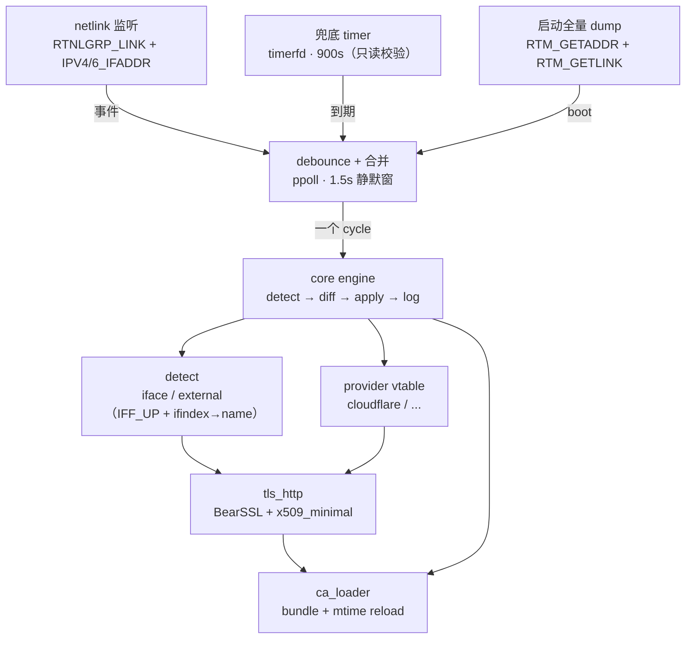

# miniddns — 设计方案与实现规格

> **Implementation Specification** · 极低资源占用的多提供商动态 DNS 守护进程（C99 + netlink + BearSSL）
>
> 版本 **1.2**（+ 1.2.1 实现回写）· 状态：设计冻结，**已实现**（见 `docs/DELIVERY.md`）· 目标读者：实现/验收本项目的工程 agent

| 文档项 | 说明 |
| --- | --- |
| 原始来源 | `http://119.29.168.148/pub/report/miniddns-design.html`（内网明文地址，仅作溯源，不可复现） |
| 原文快照 | `docs/archive/design-v1.1.html`（只读存档，96 789 bytes，`sha256=ebb37501…8ec59c`，校验方法见 `docs/archive/README.md`） |
| 本文件 | `docs/design.md`，**唯一权威版本**：v1.1 正文的 Markdown 整理版 + v1.2 修订 |
| 整理说明 | 章节结构、表格、代码块与全部约束条款与原文一致；流程图重绘为 Mermaid；保留章节锚点，目录可跳转 |
| 路径说明 | 正文中的 `doc/design.html`、`doc/` 目录为原设计规格冻结的源码/产物布局，按原文保留未改；本仓库的文档存放目录为 `docs/` |
| v1.2 修订 | 依 `docs/review-design-v1.1.md` 全量修订 40 项（P0×10 / P1×18 / P2×12），逐项对照见该报告 §6；破坏性变更见 `CHANGELOG.md` |
| 效力 | 本文档为实现的唯一依据；与实现冲突时以规格正文为准并回写修订（流程见 §04.7） |

### 阅读路径

| 你的角色 | 建议顺序 |
| --- | --- |
| 评审 / 决策 | 关键约束速览 → §01 → §16 → 附录 A.5 自查清单 |
| 实现者（第一次） | §02 → §03 → §04 → §05 → §06 → §07 → §08 → §09 → §13.1 → §14.1 |
| 实现者（按里程碑推进） | §15 选阶段 → 回本阶段相关章节 → §14 找该阶段验收项 |
| 打包 / 运维 | §03（路径与权限）→ §11（CLI）→ §12（systemd/OpenWrt）→ §13.3（dist）→ §14.5（资源门禁） |
| 排障 | §10.2（必须存在的日志行）→ §06.3（为什么没探测到 IP）→ §08.4（错误码含义） |

## 目录

- [关键约束速览](#overview)
- [01 目标与非目标](#s1)
- [02 架构总览](#s2)
- [03 部署布局与路径解析](#s3)
- [04 配置文件规范](#s4)
- [05 运行时行为规格](#s5)
- [06 IP 探测算法](#s6)
- [07 Provider 抽象层](#s7)
- [08 TLS 与 HTTP 客户端](#s8)
- [09 CA 加载器](#s9)
- [10 日志规范](#s10)
- [11 命令行接口](#s11)
- [12 systemd 集成](#s12)
- [13 构建与打包](#s13)
- [14 测试与验收](#s14)
- [15 实施里程碑](#s15)
- [16 风险与未决问题](#s16)
- [A 附录：常量、错误码、权限](#sa)

<a name="overview" id="overview"></a>

## 关键约束速览

> 以下是原文硬性约束的索引式摘录，便于实现时快速核对；完整语义以对应章节为准。

| 类别 | 不可协商的约束 | 出处 |
| --- | --- | --- |
| 资源 | 常驻 RSS ≤ 2.5 MB、峰值 ≤ 6 MB、24 h 累计 CPU ≤ 2 s、静态二进制 ≤ 500 KB | §01 · §14.5 |
| 正确性 | IP 未变化时**零写入请求**；不写状态文件，远端记录为唯一真相来源；`record_id` 预置不参与决策（已删除该配置项） | §01 · §05.4 · §14.4 |
| 响应性 | 地址变化后 ≤ 3 s 内发出**首个**请求（不含 HTTP 超时重试）；debounce 默认 1.5 s、硬上限 10× = 15 s | §01 · §05.3 |
| 事件模型 | netlink 边沿触发 + 低频兜底 `timerfd`（默认 900 s），**无常驻轮询**；单线程事件循环 | §01 · §02 · §05.1 |
| 安全 | 证书严格校验、失败即中止（fail closed）、无降级路径；token 不进命令行/日志/环境 | §01 · §08.4 · §03 |
| 更新语义 | 只允许 PATCH 且仅带 `content`，**禁止 PUT**；`ttl`/`proxied` 只在创建时生效 | §07.3 · §07.4 |
| 探测 | 私有/保留 IPv4 与 temporary/dadfailed IPv6 一律不发布；IPv6 规范化后比较 | §06 |
| systemd | `RestrictAddressFamilies` 必须含 `AF_NETLINK`；**禁止** `PrivateNetwork=yes` | §12.1 |
| 验收闸门 | `--check-ca` 必须实现；IP 不变时 24 h 写请求数为 0 | §09.6 · §14 · 附录 A.5 |

<a name="s1" id="s1"></a>

## 01 目标与非目标

先把边界钉死。凡不在“目标”里的功能，一律不实现。

### 目标

| 维度 | 要求 |
| --- | --- |
| 资源占用 | 常驻 RSS ≤ 2.5 MB；idle **无常驻轮转**（阻塞在 `ppoll` 上，仅兜底 timer 每 900 s 唤醒一次）；24 小时累计 CPU ≤ 2 s；静态二进制 ≤ 500 KB |
| 响应性 | 地址变化后 ≤ 3 s 内发出**首个**更新请求（debounce 默认 1.5 s）。该指标不含 HTTP 超时后的重试，也不含 debounce 硬上限（§05.3）被触发的情形 |
| 正确性 | IP 未变化时**零写入请求**；只有变化/缺失时才写；幂等。该不变量优先于任何"省一次 API 调用"的优化（见 §04 为何没有 `record_id`） |
| 可运维性 | 只依赖 systemd + journald；日志结构化、可 grep；无状态文件 |
| 可移植性 | Debian / Alpine(musl) / OpenWrt 静态运行；无运行时动态库依赖（可选取） |
| 可扩展性 | Provider 通过 vtable 插拔；v1 只实现 Cloudflare，接口必须为其后的 deSEC / RFC2136 / DNSPod 留位 |
| 安全 | 证书必须严格校验，失败即中止（fail closed）；API token 不出现在命令行/日志/进程环境里 |

### 非目标 `明确不做`

- **不做短周期轮询**。事件驱动为主；兜底 `timerfd` 每 `interval_fallback`（默认 900 s）**只做一次全量校验**（dump + 每记录一次 discover），IP 未变时不产生任何写请求。不存在"每 1–5 分钟跑一次"的轮询路径。
- **不做公网 IP 以外的 DNS 管理**：不管理 MX/TXT/CAA，不做 zone 级操作，不做 DNSSEC/NS 配置。
- **不支持 HTTP 代理、HTTP/2、TLS 1.3、客户端证书、AIA 抓取**（见 §16 风险）。
- **不写状态文件**。远端记录是唯一的真相来源（source of truth）。
- **不做 Web UI、不做多进程/多线程**。单线程事件循环。

### 已冻结的技术选型

| 决策 | 选择 | 理由（不可再讨论） |
| --- | --- | --- |
| 语言 | C99 | 无运行时开销，静态产物最小 |
| 地址变化检测 | netlink `NETLINK_ROUTE` 组播订阅 + 阻塞 `recvmsg` | 内核边沿触发，idle 时无轮转无唤醒（兜底 timer 除外）；无 fork/exec/文本解析 |
| TLS | BearSSL（源码 vendor） | 纯 C、零依赖、默认无 malloc、无 I/O 绑定、MIT |
| HTTP | 自研 HTTP/1.1 最小客户端 | 只用 `Connection: close` + 定长/EOF 读取；**实现最小 chunked 解码**（§08.3），不做 ALPN/h2/gzip |
| JSON | jsmn（单头文件 vendor） | 仅从响应里取 `result[0].id` / `.content` / `errors[]`；不做通用 JSON 树（§07.3） |
| CA | 运行期解析 PEM bundle + mtime 重载 | 常驻进程必须能跟上根证书轮换；编译期固化会静默失效 |
| 配置格式 | INI（`[section]` + `key = value`，可重复 section） | C 实现最省事，允许注释，无转义地狱 |
| 定时 | `timerfd` + `ppoll` | 与 netlink fd 同一事件循环，不引入信号处理 |

<a name="s2" id="s2"></a>

## 02 架构总览

一条事件流水线，四个可替换的边界：探测、提供者、传输、信任。



> 一条事件流水线，四个可替换的边界：探测（`detect`）、提供者（`provider vtable`）、传输（`tls_http`）、信任（`ca_loader`）。`tls_http` 每次请求从 `ca_current()` 取信任锚（§08 · §09.4）。

### 模块与职责

| 模块 | 依赖 | 职责 | 不做的事 |
| --- | --- | --- | --- |
| `main.c` | 全部 | 参数解析、配置加载、信号处理、事件循环调度 | 不含业务逻辑 |
| `cfg.c` | libc | INI 解析、默认值、交叉校验、路径解析 | 不打开任何网络/证书文件 |
| `log.c` | libc | 分级日志、结构化 key=value 输出、`<PRI>` 前缀、值转义、rate limit | 不做日志轮转（journald 负责） |
| `nl_addr.c` | libc + kernel headers | netlink socket、订阅、dump、事件解码为 `struct mn_addr`；维护 `ifindex → {ifname, flags}` 缓存（`RTM_GETLINK` + `if_indextoname`） | 不做选择策略（交 detect） |
| `detect.c` | nl_addr, tls_http | 按 §06 规则把地址集合收敛为一个可发布的 IP（含 `IFF_UP` 过滤与分类校验） | 不发 provider 请求 |
| `ca.c` | BearSSL | PEM→trust anchor、mtime 检测重载、到期告警 | 不做链验证 |
| `tls_http.c` | BearSSL + ca | HTTPS 请求/响应、错误分类、超时 | 不含 provider 语义 |
| `provider.c` | tls_http, jsmn | vtable 注册表、通用 diff/apply 流程 | 不含具体 API 细节 |
| `prov_cloudflare.c` | provider | CF API 的 discover/update/create | 不碰 socket/TLS |
| `json_util.c` | jsmn | 封装 jsmn 的取字段/取错误消息 | 不做通用 JSON 树 |

> **说明 · 目录骨架**
>
> ```
> miniddns/
> ├── src/
> │   ├── main.c cfg.c cfg.h log.c log.h
> │   ├── nl_addr.c nl_addr.h detect.c detect.h
> │   ├── ca.c ca.h tls_http.c tls_http.h
> │   ├── provider.c provider.h prov_cloudflare.c
> │   ├── json_util.c json_util.h util.c util.h
> ├── third_party/
> │   ├── bearssl/{inc,src,LICENSE.txt}   # 源码 vendor，不加子模块
> │   └── jsmn/{jsmn.h,LICENSE}
> ├── systemd/                     # ★ 随源码分发，随产物打包
> │   ├── miniddns.service.in      # 模板（@BINDIR@ / @CONFDIR@ / @DOCDIR@ 占位）
> │   ├── miniddns.service         # make units 生成的成品（★ 勿手改，CI 用 verify-units 防漂移）
> │   └── miniddns.service.d/user-nonroot.conf   # 非 root 运行的 drop-in（§12.4）
> ├── openwrt/
> │   ├── Makefile                 # OpenWrt 包定义（DEPENDS:=+ca-bundle）
> │   └── files/miniddns.init      # procd 脚本（OpenWrt 无 systemd，见 §12.6）
> ├── install.sh                   # 一键安装（替换占位符 + daemon-reload）
> ├── tests/                       # 单元 + 集成 + 故障注入
> ├── dist/                        # make dist 产物
> ├── docs/{design.md,archive/,review-design-v1.1.md}
> ├── Makefile
> ├── conf/miniddns.conf.example
> ├── README.md  CHANGELOG.md  LICENSE  THIRD_PARTY_NOTICES.md  .gitignore
> └── doc/{design.md,design.html}    # 产物内文档（design.html 由 `make doc` 从 docs/design.md 生成）
> ```

> **说明 · systemd 单元属于源码，不是部署者的手工作业**
>
> 本项目的单元文件**必须随源码提交、随 `make dist` 打包**，且与二进制一起纳入版本管理。理由：加固清单（`AF_NETLINK`、`PrivateNetwork` 禁忌）是正确性的一部分，任何人的手抄版本都可能漏项。详见 §12。
>
> `systemd/miniddns.service` 是**生成物**（由 `.service.in` + `make units` 生成）。它入库只是为了方便直接 `cp`，因此**禁止手改**：CI 必须跑 `make verify-units`（重新生成后 `diff`），否则模板与成品必然会漂移。

<a name="s3" id="s3"></a>

## 03 部署布局与路径解析

自包含优先：程序目录下的 `conf/` 是默认配置位置，缺失时才回落到系统 `/etc`。

### 发布产物布局（artifact root）

```
miniddns-$(VERSION)-linux-<arch>-<libc>/   # 完整清单以 §13.3 为准（单一事实源）
│                                       # arch = x86|x64|arm32|arm64, libc = musl|glibc
├── README.md                        # 自包含目录结构与快速上手（v1.2.3 新增）
├── bin/miniddns                     # musl 版静态；glibc 版动态链接
├── conf/{miniddns.conf.example,README.md}   # 配置示例与说明；*注意* 不叫 miniddns.conf
├── examples/                        # 额外配置/服务器配置示例
├── ca/ca-certificates.crt           # 全量 CA 快照（兜底）
├── ca/README                        # 快照日期 + sha256 + 来源说明
├── systemd/{miniddns.service,miniddns.service.in,miniddns.service.d/}
├── openwrt/{Makefile,files/miniddns.init}
├── install.sh   SHA256SUMS   LICENSES/   THIRD_PARTY_NOTICES.md
├── doc/design.md                    # 本文档（权威版本，随产物分发）
└── doc/design.html                  # 由 `make doc` 从 design.md 生成（可选，需 pandoc）
```

> **注意 · 版本号写法**
>
> 产物目录名一律用 `$(VERSION)`、`$(ARCH)` 变量渲染，不在文档中写死具体版本号（历史上这里写成 `1.0.0`，而 §12.2 的示例写 `1.1.0`，已修正）。

> **注意 · 为什么示例文件必须叫 `.example`**
>
> 程序目录的 `conf/` 优先级高于 `/etc`。如果包里自带 `conf/miniddns.conf`，用户放在 `/etc/miniddns/` 的覆盖配置就永远不生效。因此：
>
> - **便携模式**：用户自己 `cp miniddns.conf.example conf/miniddns.conf` → 程序目录配置生效
> - **系统打包模式**：包内只放 `.example` → 自动回落到 `/etc/miniddns/miniddns.conf`
> - **OpenWrt**：同一机制，`/usr/share/miniddns/conf/` 只放 example，用户配置在 `/etc/miniddns/`（overlay 可写）

### artifact root 的确定方式

**必须**用 `readlink("/proc/self/exe")` 取真实路径，**禁止**使用 `argv[0]` 或当前工作目录（CWD 在 daemon 下不可信）。然后依次探测（注意：探测**具体文件**而不是目录，否则 `/usr/local/conf` 之类的无关目录会造成误判）：

1. `dir = dirname(exe)`；若 `dir/conf/miniddns.conf` 或 `dir/ca/ca-certificates.crt` 存在 → `root = dir`（扁平布局 `miniddns` + `conf/` 同级）
2. 否则若 `dirname(dir)/conf/miniddns.conf` 或 `dirname(dir)/ca/ca-certificates.crt` 存在 → `root = dirname(dir)`（`bin/miniddns` 布局）
3. 否则 `root = NULL`（纯系统安装，全部走 `/etc` 与系统 CA）

> **说明 · 便携模式与版本化目录不兼容**
>
> §12.2 方案 A 把程序装在 `/opt/miniddns-<版本>/`，此时 `<root>` 是**带版本的目录**：用户写在 `<root>/conf/miniddns.conf` 的配置在升级时会被新目录"带走"。因此：
> - **系统模式（推荐）**：配置一律放 `/etc/miniddns/miniddns.conf`，方案 A 升级无感；
> - **便携模式**：不要用版本化目录，或把 `<root>/conf` 做成指向共享目录的符号链接（§03 权限策略允许 conf 为符号链接）。

### 配置文件的查找顺序

| 优先级 | 路径 | 说明 |
| --- | --- | --- |
| 1 | `--config <path>` | 命令行显式指定；不存在即**报错退出**（不回落） |
| 2 | `<root>/conf/miniddns.conf` | 程序目录自带配置（便携模式） |
| 3 | `/etc/miniddns/miniddns.conf` | 系统安装位置 |

都找不到 → `exit(1)`，日志给出所有尝试过的路径。**启动日志必须打印实际使用的配置文件路径**（这是排障第一信息）。

### CA bundle 的查找顺序

| 优先级 | 路径 | 说明 |
| --- | --- | --- |
| 1 | 配置项 `core.ca_bundle` | 显式指定；加载失败即 `exit(1)`，**不回落** |
| 2 | `<root>/ca/ca-certificates.crt` | 产物自带快照（兜底，见 §09） |
| 3 | `/etc/ssl/certs/ca-certificates.crt` | Debian / OpenWrt (`ca-bundle`)；部分发行版为符号链接 |
| 4 | `/etc/pki/tls/certs/ca-bundle.crt` | RHEL 系；**恒为符号链接**（→ `…/extracted/pem/tls-ca-bundle.pem`） |
| 5 | `/etc/ssl/cert.pem` | Alpine；与 3 互为符号链接（方向因版本而异） |
| 6 | `/etc/ssl/ca-bundle.pem` | openSUSE |

> **强制 · CA bundle 候选路径允许符号链接**
>
> 上表 3–6 在多个发行版上至少有一个是符号链接。若对 CA bundle 也施加 `O_NOFOLLOW`，RHEL 系与 Alpine 将**必然拒绝启动**。因此符号链接策略必须分级，见下节。

> **注意 · 内置快照优先于系统 CA 的代价**
>
> 程序目录优先意味着系统 CA 更新不会自动生效。这不致命，因为 §09 的 `notAfter` 告警 + `--check-ca` 自检会把问题暴露在装机当天。若部署方希望跟随系统 CA，在配置里写 `ca_bundle = /etc/ssl/certs/ca-certificates.crt` 并把 `ca/` 目录删掉即可。

### 文件权限与符号链接策略 `强制`

能改写 CA bundle 或 token 的人即可 MITM 你的请求，因此必须校验；但"一律拒绝符号链接"会打死多数发行版与常见运维形态。按对象分级：

| 对象 | 符号链接 | 打开方式 | 额外校验 |
| --- | --- | --- | --- |
| **token 文件** | **禁止**（`st_uid/mode` 看着安全、实际指向别处是典型绕过手法） | `O_RDONLY\|O_NOFOLLOW\|O_CLOEXEC` | 必须 `S_ISREG`；≤ 256 KiB；单行；读入后清零缓冲前不打印 |
| **配置文件**（含 `--config`） | 允许 | 先 `realpath()`，再 `open(O_RDONLY\|O_CLOEXEC)`，`fstat()` 校验**目标** | 目标 `S_ISREG`；≤ 256 KiB；目标属主 root（可用 `--allow-non-root-owner`）；目标 `st_mode & (S_IWGRP\|S_IWOTH)` 必须为 0 |
| **CA bundle** | **必须允许**（§03 表中 3–6 多为符号链接） | 同上：`realpath()` + `open` + `fstat()` | 目标 `S_ISREG`；≤ 2 MiB；目标属主 root（同上可覆盖）；目标不得 group/world 可写。**额外**：`realpath()` 结果必须落在白名单目录内（`/etc/`、`/usr/share/`、`<root>/`），防止 `ca_bundle` 被指向 `/tmp` |

统一规则（三类都要）：

```text
S_ISREG(st_mode) == 0                      → 拒绝 "not a regular file"
st_uid != 0                                → 拒绝 "owner is not root"   (可用 --allow-non-root-owner 覆盖)
st_mode & (S_IWGRP|S_IWOTH)                → 拒绝 "group/world writable"（无覆盖选项，硬失败）
size > 2 MiB (CA) / 256 KiB (conf, token)  → 拒绝 "file too large"
```

> **注意 · 为什么不再一律 `O_NOFOLLOW`**
>
> v1.1 的规则（对所有对象 `O_NOFOLLOW` + `S_ISLNK` 硬拒）与三个真实场景互斥：RHEL 的 `ca-bundle.crt`、Alpine 的 `cert.pem`、以及多实例部署的 `/etc/miniddns/miniddns.conf -> instances/home.conf`。正确做法是"校验解析后的目标"，而不是"禁止重定向"；对 token 保留 `O_NOFOLLOW` 是因为凭据文件没有合法理由被重定向。

<a name="s4" id="s4"></a>

## 04 配置文件规范

INI 子集：`[section]` + `key = value`。`[record]` 与 `[provider]` 可重复出现。

### 04.1 语法规则（解析器必须严格实现）

- 行首行尾空白忽略；空行与纯注释行忽略；注释以 `#` 或 `;` 起始（**仅在行首**，不做行尾注释，避免 token 里出现 `#` 被截断）
- `key` 与 `value` 大小写不敏感（key）；value 保持原样并 trim 两侧空白
- 不支持续行、不支持引号、不支持转义
- **未知 key、未知 section、重复的非重复 key → 硬错误并给出行号**（拼写错误必须当场发现，不能静默忽略）
- 值中的 `${ENV}` **不展开**（唯一例外是 `token_file` 的 `$CREDENTIALS_DIRECTORY/` 前缀，见下）
- **跨全文所有 `[record]` 的 `(provider, name, type)` 必须唯一**，重复即报错，并在消息中给出**两处**行号（同一 section 内本来就只能出现一次，但两条不同 `[record]` 争抢同一远端记录会导致"A 写 1.1.1.1、B 写 2.2.2.2"来回抖动）
- 数值类 key 必须做范围检查（见各表"说明"列的上下限）；`retry_backoff` 最多 8 项，项值 ∈ `[1, 86400]`

### 04.2 `[core]`

| key | 默认 | 说明 |
| --- | --- | --- |
| `instance` | `default` | 实例名，用作 lock 文件名与日志标识。仅允许 `[A-Za-z0-9._-]`，≤ 32 字符 |
| `interval_fallback` | `900` | 兜底同步周期（秒），范围 0–86400。`0` = 禁用兜底 timer（**失败退避仍生效**，见 §05.5） |
| `debounce_ms` | `1500` | 事件合并静默窗（毫秒），范围 100–60000，见 §05.3 |
| `write_memo_ms` | `60000` | "刚写成功"备忘窗口（毫秒），用于抑制 CF `GET` 缓存导致的重复 PATCH，见 §05.4.1。范围 0–600000，`0` = 关闭 |
| `ca_bundle` | *空* | CA PEM bundle 路径，空 = 按 §03 顺序探测 |
| `http_timeout_ms` | `8000` | 单次 HTTP 请求总超时（含连接、握手、收发） |
| `connect_timeout_ms` | `5000` | TCP 连接 + TLS 握手超时（须 ≤ `http_timeout_ms`） |
| `retry_backoff` | `5,15,60,300` | 失败后的重试间隔序列（秒），用尽后固定在最后一个值；最多 8 项 |
| `log_level` | `info` | `error\|warn\|info\|debug` |
| `log_target` | `journald` | `journald`（stdout+stderr 交 systemd 收集）`\|file` |
| `log_file` | *空* | `log_target=file` 时必填。**必须位于 `$LOGS_DIRECTORY` 或 `/var/log/miniddns/` 下**，否则 `ProtectSystem=strict` 下写不进去（§12.1） |
| `lock_file` | *自动* | 默认 `$RUNTIME_DIRECTORY/<instance>.lock`（无 `RUNTIME_DIRECTORY` 时 `/run/miniddns/<instance>.lock`，再失败用 `/tmp/miniddns-<instance>.lock`） |
| `clock_guard_epoch` | `1700000000` | 系统时间早于此值视为时钟未同步（§05.6） |

### 04.3 `[detect]`

| key | 默认 | 说明 |
| --- | --- | --- |
| `ipv4_mode` | `auto` | `off \| iface \| external \| auto`（见 §06.2） |
| `ipv6_mode` | `iface` | `off \| iface`（IPv6 无 NAT，故无 `external`；也**没有** `auto`：v6 的 `iface` 就是唯一来源） |
| `iface_include` | *空* | 逗号分隔的接口名白名单；空 = 所有接口。**接口必须 `IFF_UP`**（硬规则，不可配置） |
| `iface_exclude` | `lo,docker0,veth*,br-*,virbr*,tun*,tap*,wg*` | 逗号分隔，支持尾部 `*` 通配（仅尾部，不支持中间/正则） |
| `ipv4_echo_url` | 见下 | 逗号分隔的探测端点，按序尝试。**其中出现过的 host 集合即重定向白名单**（§06.2） |
| `allow_private_ipv4` | `false` | 为 true 时允把私网地址当作待发布 IP（**仅测试用**，Cloudflare 会拒绝） |
| `allow_temporary_ipv6` | `false` | 是否允许发布隐私扩展临时地址（不建议） |

```
ipv4_echo_url = https://api.ipify.org,https://ipv4.icanhazip.com,https://ipv4.ident.me
```

> **注意 · 默认值必须属于允许值集合**
>
> 配置校验必须保证"默认值 ∈ 枚举"（v1.1 的 `ipv6_mode` 默认 `auto` 但枚举里只有 `off\|iface`，会让**不写该项的用户全部启动失败**）。§14.6 提供了一个自动检查脚本点（对每个 key 断言默认值合法）。

### 04.4 `[provider]`（可重复）

| key | 必填 | 说明 |
| --- | --- | --- |
| `id` | 是 | 本文件中唯一的实例标识，供 `[record].provider` 引用 |
| `kind` | 是 | Provider 类型，v1 只支持 `cloudflare` |
| **Cloudflare 专属** |  |  |
| `zone_id` | 是 | Zone ID（32 位 hex）。v1 **不**按 zone 名自动解析 |
| `token_file` | 是* | API Token 文件路径（0600），读第一行并 trim。支持 `$CREDENTIALS_DIRECTORY` 展开（见下） |
| `token` | 否 | 内联 token，**仅测试用**；存在时打 warn 日志，且 `--check-config` 输出中打码 |

\* `token_file` 与 `token` 至少给一个。两者都给 → `token_file` 优先，并 warn。

> **说明 · token_file 的 `$CREDENTIALS_DIRECTORY` 展开（唯一允许的变量展开）**
>
> 若值以 `$CREDENTIALS_DIRECTORY/` 开头，则替换为 systemd 设置的 `CREDENTIALS_DIRECTORY` 环境变量值。
>
> - **守护进程路径**：该变量不存在时报错 `E_CFG`（因为 `token_file` 无法解析）；
> - **诊断路径**（`--check-config` / `--check-ca` / `--print-ip`）：该变量不存在时**降级为 warn 并跳过凭据校验**，不得报错退出。因为这三个命令常在 systemd 之外运行（打包验收、`postinst`、`ExecStartPre`），正是它们最需要能跑通。
>
> 配合 `LoadCredential=`（§12.1，**可选**）时，token 只出现在内存 tmpfs 里，不落盘、不进环境。注意 `LoadCredential=` 的源路径不存在会让**单元启动失败**（`status=243/CREDENTIALS`），所以它必须是可选项，不能写死在单元里。

### 04.5 `[record]`（可重复）

| key | 默认 | 说明 |
| --- | --- | --- |
| `provider` | 必填 | 引用某个 `[provider].id` |
| `name` | 必填 | 完整记录名（FQDN，不带结尾点）。校验：≤253 字符、只含 `[A-Za-z0-9.-_]`、至少一个点 |
| `type` | 必填 | `A` 或 `AAAA`（大写，大小写不敏感输入） |
| `ttl` | `60` | 创建时使用；更新时不覆盖（见 §07.4）。范围 60–86400，或 `1` 表示 Auto |
| `proxied` | `false` | 仅创建时使用；更新时不覆盖 |
| `create_if_missing` | `true` | 远端不存在时是否创建 |
| `enabled` | `true` | 临时禁用某条记录 |

> **强制 · 没有 `record_id` 预置项（v1.2 删除）**
>
> v1.1 曾提供 `[record].record_id`，号称"填写则跳过 discover，省一次 API 调用"。它必须删除，理由：
> 1. 跳过 discover 后，进程**无法得知远端 `content`**（§01 又禁止写状态文件），于是只能每轮都 PATCH——直接违反"IP 不变零写入"这个核心不变量；
> 2. v1.1 的伪代码在这种情况下 `found` 恒为 0，会误走 **create** 分支，产生永久 API 错误；
> 3. 手工维护的 record id 在远端记录被删/重建后会变成悬空 id，且难排查。
>
> 若确实想减少 GET：用 `[core].write_memo_ms`（§05.4.1）——它只在"刚写成功的一分钟内"抑制重复写，不破坏不变量。

### 04.6 完整示例

```ini
# /etc/miniddns/miniddns.conf            -*- mode: ini -*-
[core]
instance          = home
interval_fallback = 900
debounce_ms       = 1500
write_memo_ms     = 60000
log_level         = info
# 跟随系统 CA 而不是产物快照：
# ca_bundle       = /etc/ssl/certs/ca-certificates.crt

[detect]
ipv4_mode      = auto
ipv6_mode      = iface
iface_exclude  = lo,docker0,veth*,br-*,virbr*,wg*

[provider]
id         = cf-main
kind       = cloudflare
zone_id    = 023e105f4ecef8ad9ca31a8372d0c353
token_file = /etc/miniddns/cloudflare.token
# 若使用 systemd 凭据目录（需在单元里显式 LoadCredential=，见 §12.1）：
# token_file = $CREDENTIALS_DIRECTORY/cloudflare.token

[record]
provider    = cf-main
name        = home.example.com
type        = A
ttl         = 60
proxied     = false

[record]
provider    = cf-main
name        = home.example.com
type        = AAAA
ttl         = 60
proxied     = false
```

### 04.7 版本兼容与规格变更流程

本节回答"加一个配置项会不会把老用户打死"。

| 变更类型 | 兼容性 | 必须做的事 |
| --- | --- | --- |
| 新增 key（带默认值） | **破坏**：旧二进制的"未知 key 硬错误"会拒绝启动 | 在 `CHANGELOG.md` 标 **破坏性**，bump 规格 minor（v1.x）；文档明确"先升级二进制，再改配置" |
| 新增 key（无默认，必填） | 同上，且强制用户改配置 | 同上，并在启动错误消息里给出建议值 |
| 删除 key | 破坏 | 提供至少一个 minor 版本的"已弃用但仍解析（只 warn）"过渡期 |
| 修改默认值 | 兼容但改变行为 | CHANGELOG 里必须写清单；`--check-config` 输出实际生效值 |
| 删除枚举值 | 破坏 | 同"新增 key" |
| 日志字段增删 | 兼容 | 不改变现有字段名与顺序；`action=` 取值集合变更需记 CHANGELOG |

**回写机制**：实现中发现规格与内核/API 实际不符时，以**实际行为**为准修改规格正文，并在文末"修订记录"追加一行（版本 + 一句话 + 对应章节）；不得默默偏离。评审报告（`docs/review-design-v1.1.md`）保留历史结论，不随规格回写而修改。

<a name="s5" id="s5"></a>

## 05 运行时行为规格

单线程：netlink + `timerfd` + `signalfd` 三个常驻 fd，一个 `ppoll`。除兜底 timer 外没有任何周期性“检查”。

### 05.1 进程生命周期

```text
main()
 ├─ 解析 CLI（§11）；`--once` 之后的路径必取 flock，其余诊断命令不取
 ├─ 定位配置文件 → 解析 → 校验                    失败 → exit(1)
 ├─ 打开并 flock(lock_file, LOCK_EX|LOCK_NB)      已占用 → log+exit(0)
 ├─ 加载 CA（§09）                                 失败 → exit(1)
 ├─ provider 注册与 init（token 读取、配置校验）    失败 → exit(1)
 ├─ nl_open()：socket + bind(组) + 首次全量 dump    失败 → exit(1)
 ├─ install SIGTERM/SIGINT → signalfd 或 self-pipe
 ├─ 一次启动 cycle（reason=boot）                  IP 相同 → 零写入
 └─ loop:
      ppoll([nl_fd, timer_fd, sig_fd], 无限)
        · nl_fd 可读     → 读事件 → 标记 pending → 启动 debounce 窗口
        · debounce 到期  → cycle(reason=event)
        · timer_fd 到期  → cycle(reason=timer)
        · sig_fd 可读    → 清理后 exit(0)
```

> **说明 · 为什么用 signalfd 而不是信号处理函数**
>
> 异步信号会打断 `ppoll`/`recvmsg`/TLS 状态机，处理不当就是 `EINTR` 地狱。用 `signalfd` 把信号变成 fd 可读事件，退出路径唯一且可重入。必须 `sigprocmask(SIG_BLOCK)` 这三个信号之后再 `signalfd`。

### 05.2 netlink 监听

| 项 | 规格 |
| --- | --- |
| socket | `socket(AF_NETLINK, SOCK_RAW\|SOCK_CLOEXEC, NETLINK_ROUTE)` |
| 订阅组 | `RTNLGRP_LINK` \| `RTNLGRP_IPV4_IFADDR` \| `RTNLGRP_IPV6_IFADDR`；`bind()` 时用 `nl_groups` 位掩码：`(1u<<(RTNLGRP_LINK-1)) \| (1u<<(RTNLGRP_IPV4_IFADDR-1)) \| (1u<<(RTNLGRP_IPV6_IFADDR-1))`。**必须含 `RTNLGRP_LINK`**，否则拿不到接口 up/down 与接口名（§06.3） |
| 顺序 | **先 bind 订阅，再发 `RTM_GETADDR` dump**。反过来会丢失两者之间的变化 |
| dump | `RTM_GETADDR` + `NLM_F_REQUEST\|NLM_F_DUMP`，`nlmsg_seq` 唯一；用 `NLMSG_DONE`/`NLMSG_ERROR` 终止；后续收到 `nlmsg_seq` 不同的事件即进入事件模式。启动时**额外**发一次 `RTM_GETLINK` 建 `ifindex → {ifname, IFF_UP\|IFF_RUNNING}` 表 |
| 接收缓冲 | 请求 `SO_RCVBUF = 1 MiB`，但**必须 `getsockopt` 读回实际值**：无 `CAP_NET_ADMIN` 时不能用 `SO_RCVBUFFORCE`，内核会将它钳到 `2 × net.core.rmem_max`（常见发行版默认 ~416 KiB）。实际值 < 256 KiB → `warn rcvbuf_actual=<n> hint=net.core.rmem_max`，但不终止 |
| 读取 | 每次 `recvmsg` 读 32 KiB，循环 `NLMSG_OK` 遍历。必须处理消息被拆分（`NLMSG_DONE` 之外的截断靠 buffer 大小避免） |
| 关注的事件 | `RTM_NEWADDR`、`RTM_DELADDR`、`RTM_NEWLINK`、`RTM_DELLINK`；收到 LINK 类事件时刷新 ifindex 表（`ifname`/`IFF_UP`） |
| 解码内容 | `ifaddrmsg`{family, prefixlen, flags, scope, index} + attrs：`IFA_ADDRESS`、`IFA_LOCAL`、`IFA_FLAGS`（32 位，优先于 `ifa_flags` 那 8 位）、`IFA_CACHEINFO`（valid/preferred lifetime）、`IFA_LABEL`（**仅 IPv4 存在**，仅用作冗余校验；接口名一律 `if_indextoname(ifa_index)`） |
| `ENOBUFS` | **必须**：`recvmsg` 返回 `ENOBUFS` 时 log warn + 重新执行一次全量 dump（含 LINK）重建状态，**同时清 `pending` 并取消当前 debounce 窗口**（说明内核丢事件，任何增量假设都不可信） |
| 权限 | 不需要 root、不需要 `CAP_NET_ADMIN` |

> **注意 · 不要只靠事件维护状态**
>
> 实现上应把“地址集合”当作可由 dump 重建的缓存，事件只用来**触发**重新评估。任何不确定状态（`ENOBUFS`、dump 失败、接口 down）都走“重新 dump”这条路径，而不是试图增量修补。

### 05.3 debounce 与触发源

一次地址变化会产生多条事件（`tentative`→`preferred`、deprecate、临时地址增删）。因此：

- 收到任意事件 → 置 `pending=1`，并把 debounce deadline 设为 `now + debounce_ms`
- debounce 窗口内再来的事件 → **重置** deadline（滑窗静默）
- 窗口静默到期 → 执行一次 cycle，清 `pending`
- 连续事件导致 deadline 不断后移时，设硬上限 `max_defer = 10 × debounce_ms`，超时强制执行（防止 ISP 抖动导致永不执行）
- 兜底 timer 到期时若 `pending=1`，直接执行 cycle 并清 pending
- debounce 计时器与 retry 计时器**共用一个 timerfd**（只存一个"最近到期"）；每次重新设定前先 `timerfd_settime` 覆盖旧值，避免两个定时源互相看不到对方
- `debounce_ms=0` 不允许（下限 100）；若未来要支持"立即执行"，用 `debounce_ms=100` 表达

### 05.4 cycle 伪代码（Provider 无关）

```c
cycle(reason):
  log_info("cycle start reason=%s", reason)
  addrs = nl_rescan()                    # 全量 dump（含 ifindex→{ifname,flags} 缓存）
  ok = 0; fail = 0; t0 = now_ms()
  for rec in records where enabled:
      want = (rec.family == AF_INET) ? detect_ipv4(addrs) : detect_ipv6(addrs)
      if (!want):
          log_info("record name=%s type=%s action=skip reason=no-ip", ...)
          ok++                       # 无 IP 不是错误，不计入 fail
          continue
      if (memo_hit(rec, want)):      # 见 §05.4.1
          log_info("record ... action=unchanged reason=write_memo ip=%s", want)
          ok++; continue
      rc = provider_discover(rec, &remote)      # 每次 cycle 必做，无例外
      if (rc != MN_OK) { log_error(...); fail++; continue; }
      if (!remote.found):
          if (!rec.create_if_missing) {
              log_info("record ... action=skip reason=absent"); ok++; continue
          }
          rc = provider_create(rec, want, &remote)
          if (rc != MN_OK) { fail++; continue }
          memo_set(rec, want); ok++
          log_info("record ... action=create ip=%s id=%s duration_ms=%d", ...)
      else if (ip_equal(remote.content, want, rec.family)):
          log_info("record ... action=unchanged ip=%s", want); ok++
      else:
          rc = provider_update(rec, &remote, want)
          if (rc != MN_OK) { fail++; continue }
          memo_set(rec, want); ok++
          log_info("record ... action=update old=%s new=%s provider=%s duration_ms=%d", ...)
  log_info("cycle end ok=%d fail=%d duration_ms=%d next=%s", ok, fail, now_ms()-t0, next_trigger)
```

**逐条记录独立成败**：一条记录失败不阻止其他记录继续。整体 cycle 结果用于计算重试退避（`fail > 0` 即整体失败）。

**不变量**：`action=update|create` 只在上面的两个分支出现；`action=unchanged` 与 `action=skip` **绝不产生写请求**。此规则需有集成测试守护（§14.2）。

### 05.4.1 write memo（抑制重复写）

Cloudflare 的 `GET /dns_records` 有秒级缓存。若刚 PATCH 完就立刻 discover，可能读回旧值，导致下一轮又 PATCH 一次（无害但计入写请求）。用一个**纯进程内**的小备忘解决：

- 每条记录维护 `{ ip, mono_ms }`，仅在 `provider_create/update` **成功后**写入；
- 命中条件：`want == memo.ip` **且** `now - memo.mono_ms < write_memo_ms`（默认 60 000 ms）；
- 命中时跳过本轮 discover 与写，记 `action=unchanged reason=write_memo`；
- 进程重启后备忘为空，行为回到"必 discover"。

**与不变量不冲突**：它只能抑制"刚刚写成功的同一个 IP"，不会掩藏外部变更（窗口过后照常 discover）；它不存磁盘，不属于§01 禁止的"状态文件"。

### 05.5 重试与退避

| 情形 | 动作 |
| --- | --- |
| cycle 全部成功（`fail == 0`） | 清空退避计数；等待下一次事件或 `interval_fallback` |
| 任一记录失败 | 按 `retry_backoff` 序列预约一次 retry：`delay = (interval_fallback == 0) ? backoff : min(backoff, interval_fallback)`。**`interval_fallback=0` 绝不能算成 delay=0**（那会 disarm timerfd，失败后永不再试） |
| `HTTP 429` 且带 `Retry-After` | 用 `Retry-After` 覆盖退避（秒或 HTTP-date 两种格式都要支持；超出 `[1, 86400]` 则钳制） |
| `E_TLS_CERT` | 不快速重试（不会自愈）。按退避最大档重试，并保证日志打 error 级 |
| `E_TLS_TIME` 且时钟未同步 | 走时钟守卫路径（§05.6） |
| `E_HTTP_STATUS` 且 `http_status` 为 4xx（除 429） | 配置/token 问题，不自愈 → 用最大退避档，log error |
| 其它（`E_DNS`/`E_CONNECT`/`E_TIMEOUT`/`E_TLS_HANDSHAKE`/5xx） | 正常退避序列 |

### 05.6 时钟守卫

OpenWrt 等无 RTC 设备开机时 `time()` 可能返回 1970。TLS 会以“证书尚未生效”失败，而 CA bundle 完全正常。规则：

- 任何 HTTPS 请求前检查 `time(NULL) < clock_guard_epoch`
- 命中则 log warn `clock not synced`，按 30 s 固定间隔重试，**不消耗退避计数**，不计入 cycle 失败统计
- 同时区分日志：时间类错误用 `err=E_TLS_TIME`，与 `err=E_TLS_CERT` 严格分开（否则排障会误判为 CA 坏了）
- 时钟守卫生效期间**不做任何写请求**（不是"失败重试"，而是"先不发"）；`--print-ip` 不受它影响（不发 TLS）

### 05.7 并发与域名解析

- `getaddrinfo()` 是阻塞的。接受这一点：单线程下 DNS 慢会阻塞事件处理，但**netlink 事件在内核 socket 队列里排队，不会丢失**（§05.2 的 `ENOBUFS` 处理覆盖极端情况）。
- `SO_RCVTIMEO/SO_SNDTIMEO` + `connect_timeout_ms` 保证单次请求有界；单次 cycle 的总时长上限为 `records × (discover + update)`，没有全局超时，但每步都有界。
- runner 内不做任何 `fork()`。
- **`--once` 必须取 flock**（与其他实例互斥），否则它会与运行中的守护进程并发写同一条记录；`--dry-run` / `--print-ip` / `--check-*` 不取（§11）。

<a name="s6" id="s6"></a>

## 06 IP 探测算法

把地址集合收敛成一个“可以对外发布”的 IP。所有过滤条件都必须显式实现并有单元测试。

### 06.1 地址分类判定表（必须实现为纯函数）

| 判定 | IPv4 前缀 | IPv6 前缀 |
| --- | --- | --- |
| 不可发布：私有 | `10.0.0.0/8` `172.16.0.0/12` `192.168.0.0/16` | `fc00::/7` (ULA) |
| 不可发布：CGNAT | `100.64.0.0/10` | — |
| 不可发布：回环/链路本地 | `127.0.0.0/8` `169.254.0.0/16` | `::1/128` `fe80::/10` |
| 不可发布：保留/文档/组播 | `0.0.0.0/8` `192.0.0.0/24` `192.0.2.0/24` `198.18.0.0/15` `198.51.100.0/24` `203.0.113.0/24` `240.0.0.0/4` `255.255.255.255/32` | `::/128` `ff00::/8` `100::/64` `2001:db8::/32` `fec0::/10` |
| 不可发布：组播/特殊 | `224.0.0.0/4` | `::ffff:0:0/96`（v4-mapped）`64:ff9b::/96`（NAT64） |
| 可发布 | 其余全局单播（必不在以上任一前缀内） | **必须在 `2000::/3` 内**，且不在以上任一前缀内 |

> **实现提示 · IPv6 的可发布范围不能只写"其余"**
>
> v1.1 同时写了"其余全局单播"与"`2000::/3`"，实现者容易二选一。正确规则：**先要求落在 `2000::/3`，再排除名单**。否则 `fe80::` 之外的链路本地/组播以外的异常前缀（例如某些实验段）可能被放行。

前缀比较用 `(addr & mask) == prefix` 的 32/128 位位运算，**不要**用字符串前缀匹配（`10.` 会误中 `100.64.0.1`）。

### 06.2 IPv4 选择

| mode | 行为 |
| --- | --- |
| `off` | 返回“无”。所有 A 记录记 `action=skip reason=ipv4-off` |
| `iface` | 从 dump 中取 `scope=global`、**接口 `IFF_UP`** 且通过 `iface_include/exclude` 的 IPv4；**若为私有/CGNAT → 视为“无公网 IPv4”并 log 明确原因**（`allow_private_ipv4=true` 时例外）；多个候选按 §06.4 排序取第一个 |
| `external` | 依次请求 `ipv4_echo_url`，对响应体 trim 后做 IPv4 语法 + 分类校验；第一个合法结果胜出；重定向规则见下方"强制" |
| `auto` | 先 `iface`；得到公网地址则用之，否则退到 `external`。两者都失败 → “无” |

> **强制 · external 模式的重定向白名单（配置里没有单独的键）**
>
> 白名单 = **`ipv4_echo_url` 中出现过的 host 集合**（大小写不敏感，含端口时按默认 443 归一）。规则：
> - 最多 3 跳；第 4 次重定向 → `E_HTTP_STATUS http_status=3xx`；
> - 仅允许 `https`，仅允许默认端口 443（`https://host:8443/...` → 拒绝）；
> - 目标 host 必须**精确匹配**白名单（不做子域通配）；
> - 不合法重定向 → 当前端点作废，**换下一个 `ipv4_echo_url`**，不整轮失败。

> **强制 · 必须拦截私有 IPv4**
>
> Cloudflare 会拒绝私有/保留地址作为 A 记录内容并返回 API 错误。若不在此处拦截，你的日志会变成每 15 分钟一条无意义的 API 错误。这是本方案里最容易被漏掉的一条。

### 06.3 IPv6 选择

候选必须同时满足：

- `ifa_family == AF_INET6`，`scope == RT_SCOPE_UNIVERSE`（global）
- **所在接口 `IFF_UP` 为真**（见下方 callout；这是内核不替你过滤的）
- `IFA_FLAGS` 不含：`IFA_F_TEMPORARY`(0x01)、`IFA_F_DEPRECATED`(0x20)、`IFA_F_TENTATIVE`(0x40)、`IFA_F_DADFAILED`(0x08)、`IFA_F_OPTIMISTIC`(0x04)
- （`allow_temporary_ipv6=true` 时豁免 `TEMPORARY`）
- `IFA_CACHEINFO.ifa_valid` > 0（不为 `0sec`）
- 不落在 §06.1 的不可发布前缀（先要求 `2000::/3`）
- 接口名（**`if_indextoname(ifa_index)`**，不是 `IFA_LABEL`）通过 include/exclude 过滤

全部被过滤掉时返回“无”，并 log（注意每个过滤原因用**独立的 key**，不要拼成 `filtered=temporary=2,dadfailed=1` 这种不可解析形式）：

```
<6>miniddns: record name=home.example.com type=AAAA action=skip reason=no-publishable-ipv6 candidates=3 filtered_temporary=2 filtered_dadfailed=1 level=info
```

这条日志在排障时几乎总是你要的第一条。

> **强制 · 两个容易漏的过滤条件**
>
> 1. **接口名必须用 `if_indextoname(ifa_index)`**。`IFA_LABEL` 只出现在 IPv4 的 `RTM_NEWADDR` 里，IPv6 消息压根没有这个属性；拿不到名字 → include/exclude **静默失效** → `docker0`/`wg0` 的 IPv6 会被发上去。
> 2. **必须检查接口 `IFF_UP`**。内核在 `ip link set eth0 down` 后**不会**删除地址，`RTM_GETADDR` 仍会返回它们，且 `IFA_FLAGS` 里没有"接口 down"这个位；不查 `IFF_UP` 就会把 down 掉接口的旧 IP 当候选（与 §14.3 期望的"记 `no-ip` 并跳过"正好相反）。

`IFA_CACHEINFO` 缺失时（老内核/某些接口）按 "valid 视为无穷" 处理，不要直接丢弃候选。

### 06.4 确定性排序（防抖动）

多个候选必须按**与地址插入顺序无关**的规则取一个，否则顺序变化会被误判为“IP 变了”：

1. 地址字节序升序（v4 用 `struct in_addr.s_addr` 网络序转 host 后比较；v6 用 `memcmp` 16 字节）
2. 取第一个

若配置了多个网卡且需要优先级，用 `iface_include` 只留一个接口——v1 不实现“按接口优先级排序”。

### 06.5 规范化比较

- IPv4：格式化为 `a.b.c.d`（无前导零）后字符串比较
- IPv6：**展开为 8 组 16 位十六进制的规范形式再比较**（`2001:db8::1` 与 `2001:0db8:0:0:0:0:0:1` 必须判定相等）。实现：解析成 `uint16_t[8]` 后逐元素比较，**不要**用 `strcmp` 处理 `::`
- 发布给 provider 的形式：RFC 5952 压缩小写形式（glibc/musl 的 `inet_ntop` 输出符合该形式；若自行实现，注意"同等长度取最前"与全零地址 `::`）
- 从远端读回的 content 也要走同一套规范化后再比较；远端给的是非法字符串 → 视为不一致（走 update），并 `warn reason=remote_content_invalid`

<a name="s7" id="s7"></a>

## 07 Provider 抽象层

这是本项目唯一需要“为未来设计”的地方。v1 只实现 Cloudflare，但接口必须容纳差异巨大的其他厂商。

### 07.1 数据模型

```c
/* 固定上限与长度常量——完整清单见附录 A.0 */
#define MN_IP_STRLEN      46   /* INET6_ADDRSTRLEN，含 NUL */
#define MN_FQDN_MAX      254   /* 含 NUL */
#define MN_ID_MAX         64   /* 厂商记录标识，含 NUL */
#define MN_TOKEN_MAX     512   /* 凭据上限，含 NUL */
#define MN_MAX_PROVIDERS   8
#define MN_MAX_RECORDS    32

struct mn_record_cfg {          /* 来自配置文件 */
    const char *name;           /* FQDN（已校验） */
    int         family;         /* AF_INET | AF_INET6 */
    int         ttl;            /* 仅创作用；1 = Auto */
    int         proxied;        /* 仅创作用 */
    int         create_if_missing;
    int         enabled;
    struct mn_provider *prov;   /* 指向所属 provider 实例（已解析） */
};

struct mn_remote {              /* 远端现状（仅由 discover/create 填充） */
    int  found;                 /* 0 = 不存在 */
    char id[MN_ID_MAX];         /* 厂商侧记录标识；id[0]=='\0' = 该厂商无 id（如 RFC2136） */
    char content[MN_IP_STRLEN]; /* 已规范化（§06.5） */
};

/* provider 实例（每个 [provider] section 一个） */
struct mn_provider {
    const struct mn_provider_ops *ops;   /* vtable，非空 */
    const struct mn_cfg *cfg;            /* 只读，指向 main 持有的配置 */
    const char *id;                      /* [provider].id */
    char  token[MN_TOKEN_MAX];           /* 已 trim 的凭据（仅内存）；fini 时 memset 0 */
    char  zone_id[40];                   /* 厂商私有字段示例（CF 为 32 hex）；其余实现自行扩展 */
    void *priv;                          /* 厂商私有状态，由 init 分配、fini 释放；可空 */
};

/* 全局配置（cfg.c 产出，生命周期 = 进程） */
struct mn_cfg {
    struct mn_core_cfg     core;
    struct mn_detect_cfg   detect;
    struct mn_provider_cfg providers[MN_MAX_PROVIDERS];
    struct mn_record_cfg   records[MN_MAX_RECORDS];
    size_t n_providers, n_records;
    const char *conf_path;               /* 实际使用的配置文件路径（启动日志要打） */
};
```

> **强制 · 结构定义的硬性要求**
>
> - `mn_provider` / `mn_cfg` / `MN_IP_STRLEN` 等**必须**在头文件中定义，不能只在函数签名里引用（v1.1 就是这么写的，实现者只能自创）。
> - `id[0]=='\0'` 表示该厂商不使用记录标识（RFC2136 类）；core 不得把空 id 当作错误，但在 `update()` 前应断言"厂商声明了 `MN_CAP_PATCH_CONTENT` 或已有旧记录集"。
> - 不要引入 `changed_by_us` 之类"预留但恒 0"的字段（v1.1 有，已删）：预留字段不会有人维护，只会让读者猜测它的语义。

### 07.2 vtable

```c
#define MN_CAP_PATCH_CONTENT  (1u << 0)  /* 支持只改 content 的局部更新 */
#define MN_CAP_CREATE         (1u << 1)  /* 支持创建记录 */
#define MN_CAP_TTL            (1u << 2)  /* 创建时可指定 TTL */
#define MN_CAP_PROXY          (1u << 3)  /* 支持代理/CDN 开关 */
#define MN_CAP_DISCOVER       (1u << 4)  /* 支持按 name+type 查询 */

struct mn_provider_ops {
    const char *kind;                       /* "cloudflare" */
    unsigned    caps;

    /* 校验配置、加载凭据。失败返回负数并写 err */
    int  (*init)(struct mn_provider *p, const struct mn_cfg *cfg,
                 const char *prov_id, char *err, size_t errlen);

    /* 查询 name+family 的现状。未找到返回 0 且 out->found=0 */
    int  (*discover)(struct mn_provider *p, const struct mn_record_cfg *rc,
                     struct mn_remote *out, char *err, size_t errlen);

    /* 只更新 content（MN_CAP_PATCH_CONTENT 必须置位） */
    int  (*update)(struct mn_provider *p, const struct mn_record_cfg *rc,
                   const struct mn_remote *cur, const char *ip,
                   char *err, size_t errlen);

    /* 创建（MN_CAP_CREATE 必须置位）；成功时回填 out->id */
    int  (*create)(struct mn_provider *p, const struct mn_record_cfg *rc,
                   const char *ip, struct mn_remote *out,
                   char *err, size_t errlen);

    void (*fini)(struct mn_provider *p);
};

/* 注册表 */
const struct mn_provider_ops *mn_provider_lookup(const char *kind);
```

> **说明 · 为什么 `update()` 拿得到 `cur`**
>
> 因为有些厂商（RFC2136、部分 API）需要提交完整记录集/整个 RRset 才能改一条，需要旧的 TTL/proxied/其他值。把 `cur` 传进去，这些厂商才能用同一套 core 流程。

### 07.3 Cloudflare 实现规格

| 操作 | HTTP |
| --- | --- |
| discover | `GET /client/v4/zones/{zone_id}/dns_records?type={A\|AAAA}&name={fqdn}`<br>取 `result[0]`：`.id`、`.content`。0 条 → `found=0`；>1 条 → log warn 并用第一条 |
| update | `PATCH /client/v4/zones/{zone_id}/dns_records/{record_id}`<br>body `{"content":"<ip>"}` —— **只发 content** |
| create | `POST /client/v4/zones/{zone_id}/dns_records`<br>body `{"type":"A","name":"<fqdn>","content":"<ip>","ttl":60,"proxied":false}` |
| 认证 | `Authorization: Bearer <token>`。仅 API Token；**不支持** `X-Auth-Email/X-Auth-Key` 全局密钥 |
| 成功判定 | HTTP 2xx **且** body `.success == true`。两者都要检查 |
| 失败信息 | 取 `.errors[0].code` / `.errors[0].message` 写进日志的 `api_code` / `api_msg` 字段 |
| 限速 | API 侧 1200 req/5min/user，本方案远低于此；仍必须处理 `429` + `Retry-After` |

> **强制 · 绝对禁止 `PUT /dns_records/{id}`**
>
> PUT 是整体替换，会把用户手工设置的 `proxied`、`ttl`、`comment`、`tags` 全部重置。只允许 PATCH 且只带 `content`。此规则必须有集成测试守护（断言请求体里只出现 `content` 一个键）。

**Token 权限（写进文档）**：`Zone → DNS → Edit`，Zone Resources 限定到具体 zone。禁止使用 Global API Key。

> **实现提示 · jsmn 拿到的字符串是"未解转义"的原始切片**
>
> `jsmn` 只做词法切分（返回 `type/tokstart/tokend/size`），**不解转义、不验证语义**。因此：
> - `result[0].id`：CF 是 32 位 hex，无转义，直接拷贝即可；
> - `errors[0].message`：可能含 `\"`、`\uXXXX`、换行，**不能直接拼日志**（会造成多行日志）。处理：只转义 `"` `\\` 与换行（→ `\n`），或直接取前 200 字节原样输出并加 `msg_truncated=1`；
> - 所有切片指向**同一块响应缓冲**，其生命周期不得超出该缓冲；需要长期保存时必须拷贝到自己的 arena。
> - `.success` 必须按 JSON 布尔值判断（`true`/`false`），不要把它当字符串与 `"true"` 比较。

### 07.4 TTL / proxied 的“只创建不修改”规则

更新路径**不**发送 `ttl`/`proxied`。理由：这两个字段属于用户意图（是否走 CDN、缓存多久），不该被 DDNS 守护进程覆盖。配置里的 `ttl`/`proxied` 只在创建时生效。若用户改了配置的 TTL，需要手工或用 CLI 单独处理（v1 不提供）。

### 07.5 未来 provider 的差异矩阵（用来验证 vtable 够不够用）

| Provider | 标识 | 认证 | 局部更新 | 需要的额外能力 |
| --- | --- | --- | --- | --- |
| Cloudflare | record_id | Bearer token | ✅ PATCH | — |
| deSEC | 相对域名 | Token | ✅ PATCH | 相对名换算 |
| DNSPod / 阿里云 | record_id + domain_id | ID/Secret 签名 | ✅ 专用接口 | 请求签名（HMAC） |
| RFC 2136 (nsupdate) | 无 | TSIG | ❌ 需整 RRset 替换 | DNS 报文编解码 + TSIG |
| Route53 | 无（按 RRset） | SigV4 | ❌ 需整 RRset | AWS 签名 + XML |

结论：`mn_remote.id` 用字符串而非整数、`update()` 接收 `cur`、core 不假设 GET 一定存在——这三点已覆盖上表所有差异。`v1 不实现任何非 Cloudflare provider`

<a name="s8" id="s8"></a>

## 08 TLS 与 HTTP 客户端

只做一件事：把一个定长 body 发到 https 端点，读回整个响应。别写成通用客户端。

### 08.1 BearSSL 集成要点 `逐条实现`

| 项 | 规格 |
| --- | --- |
| 上下文 | `br_ssl_client_context` + `br_x509_minimal_context` + `br_sslio_context`，放在 `struct mn_tls` 里，**不 malloc**（静态分配或调用方提供） |
| 套件 | `br_ssl_client_init_full(&sc, &xc, anchors, n_anchors)` |
| 算法注册 | 必须显式注册，缺一个就“莫名验证失败”：<br>`br_x509_minimal_set_hash(&xc, br_sha256_ID, &br_sha256_vtable)`（同样注册 sha384、sha512、sha1）<br>`br_x509_minimal_set_rsa(&xc, br_rsa_i31_pkcs1_vrfy)`<br>`br_x509_minimal_set_ecdsa(&xc, br_ec_get_default(), br_ecdsa_i31_vrfy_asn1)` |
| 调用顺序 | `br_ssl_client_init_full(&sc, &xc, anchors, n)`（内部已调用 `br_x509_minimal_init()` 写入信任锚；**0.6 不存在 `br_x509_minimal_set_trust_anchors()`**）→ 显式算法注册（防御性，`init_full` 已注册全套）→ `br_x509_minimal_set_time()` → `br_ssl_engine_set_buffer()` → **最后** `br_ssl_client_reset(&sc, host, 0)`。顺序错了会得到 `BR_ERR_BAD_STATE` |
| 随机源 | BearSSL 编译宏 `BR_USE_URANDOM`（Linux）；`PrivateDevices=yes` 下 `/dev/urandom` 仍可用。若可用，优先用 `getrandom(2)` 自己的 RNG 适配层（避免对 `/dev` 路径的依赖） |
| 信任锚 | 直接把 §09 产出的 `br_x509_trust_anchor[]` 作为 `br_ssl_client_init_full()` 的第 3/4 个参数传入（0.6 无独立 setter） |
| 时间 | `br_x509_minimal_set_time(&xc, days, seconds)`，`days` 是**自 0000-01-01 起**的天数（不是自 1970）：`days = (uint32_t)(time(NULL)/86400) + 719528`，`seconds = (uint32_t)(time(NULL)%86400)`。系数取自 BearSSL `src/x509/x509_minimal.t0` 的 `get-system-date`；用 Unix 天数会令每张证书都被判为过期（`E_TLS_TIME`） |
| buffer | `br_ssl_engine_set_buffer(&sc.eng, iobuf, sizeof iobuf, 1)`，`iobuf` ≥ 16 KiB（收发各半） |
| SNI | `br_ssl_client_set_single_rsa` 不适用；**必须**用 `br_ssl_client_reset(&sc, "api.cloudflare.com", 0)` 传 hostname（同时用于证书名匹配） |
| I/O 模型 | M1 用**阻塞 socket** + `br_sslio` + `SO_RCVTIMEO/SO_SNDTIMEO`。理由见下方 callout。M2 可选改为非阻塞 `poll` 驱动引擎 |
| 对称加密 | `br_ssl_engine_set_default_aes_gcm` / `..._chacha20_poly1305`（`init_full` 已含，勿遗漏完整 profile） |

> **建议 · 为什么阻塞 socket 在这个架构里是可接受的**
>
> 单线程下 TLS 阻塞期间 netlink 事件会在内核 socket 队列里排队，不会丢失；一次请求上限 `http_timeout_ms`（默认 8 s），而我们每几小时才真正发一次写请求。用阻塞 + `SO_RCVTIMEO` 能把 BearSSL 的状态机代码量减半，是明确的工程取舍。**若后续需要严格不阻塞，只需替换 `tls_http` 内部的 I/O 泵，接口不变。**

### 08.2 请求构造

```http
PATCH /client/v4/zones/{zone}/dns_records/{id} HTTP/1.1\r\n
Host: api.cloudflare.com\r\n
User-Agent: miniddns/{version}\r\n
Accept: application/json\r\n
Content-Type: application/json\r\n
Content-Length: {len}\r\n
Connection: close\r\n
\r\n
{"content":"203.0.113.7"}
```

- **方法、路径、Host 全部由调用方（provider）传入**，本节示例以 CF 的 update 为例。客户端内部**不允许**把方法写死（v1.1 的示例误写成 `POST`，与 §07.3"只允许 PATCH"冲突）
- **必须** `Connection: close` → 可以“读到 EOF”作为响应结束的主路径
- **禁止发送 `Accept-Encoding`**：未实现解压，任何 gzip/br 响应都会变成 `E_PARSE`（服务端默认不发压缩，但显式不发送才能确定）
- 请求路径只接受静态前缀 + 已校验片段；`name`/`zone_id` 在配置校验阶段已限制字符集，**不需要** URL 转义逻辑（但仍要做一次断言）
- body 用定长 buffer 拼接 `snprintf`，**必须检查返回值**（截断 → `E_PARSE`）；`Content-Length` 由 `strlen` 得出

### 08.3 响应处理与限额

| 项 | 规格 |
| --- | --- |
| 状态行 | 解析 `HTTP/1.x NNN`；非 1.x 拒绝（`E_PARSE reason=bad_status_line`） |
| 头部上限 | 16 KiB，超出 → `E_PARSE reason=header_too_large` |
| body 上限 | 256 KiB，超出 → 截断并 `E_PARSE reason=body_too_large`（不 OOM） |
| 需要解析的头部 | `Content-Length`（可选）；`Transfer-Encoding`；`Content-Encoding`；`Retry-After`；`Content-Type` |
| Content-Type | **仅对 provider 端点**校验含 `json`；`ipv4_echo_url` 返回 `text/plain` 完全正常，不得因此失败 |
| 结束条件 | 有 `Content-Length` → 读满；有 `Transfer-Encoding: chunked` → 走 chunked 解码；两者都无 → 读到 EOF |
| chunked | **必须实现最小解码**：只支持 `chunk-size[;ext]CRLF data CRLF ... 0 CRLF [trailer] CRLF`；不合法分块头/超长/负数 → `E_PARSE reason=bad_chunk`；不支持其他 `Transfer-Encoding` 值（→ `E_PARSE reason=transfer_encoding`） |
| Content-Encoding | 仅接受 `identity` 或缺省；出现 `gzip`/`br`/`deflate` → `E_PARSE reason=encoded_body`（因为我们禁发 `Accept-Encoding`，出现即服务端异常） |
| 重定向 | **provider 请求：不跟随**（3xx → `E_HTTP_STATUS`）。**IPv4 echo 请求：最多 3 跳**，规则见 §06.2 |

> **强制 · 为什么必须实现 chunked**
>
> v1.1 同时写了"不需要 chunked"与"无 Content-Length 则读到 EOF"。两者组合的结果是：遇到 chunked 响应时，`1a2b\r\n` 这样的块长度行会被当成 body，JSON 解析必然失败 → `E_PARSE` → 最大退避重试 → **永久失败**。Cloudflare 及具边缘节点在部分错误页/大响应上确实用 chunked。实现量约 30 行，比"解释为什么一直失败"便宜。

### 08.4 错误分类（决定退避与日志级别）

| code | 触发条件 | 日志级别 / 退避 |
| --- | --- | --- |
| `E_DNS` | `getaddrinfo` 失败（`EAI_AGAIN` 等） | warn / 正常退避 |
| `E_CONNECT` | 连接被拒/超时 | warn / 正常退避 |
| `E_TLS_HANDSHAKE` | 握手失败（非证书类） | warn / 正常退避 |
| `E_TLS_CERT` | `br_ssl_engine_last_error()` 中 x509 验证失败类 | **error** / 最大退避 |
| `E_TLS_TIME` | 证书 notBefore/notAfter 与系统时间冲突 | warn（时钟未同步时）/ 30 s 固定重试 |
| `E_HTTP_STATUS` | 非 2xx（含 3xx、4xx、5xx） | 4xx: error / 3xx、5xx: warn；触发退避。**必须同时打 `http_status=NNN` 与 `reason=`** |
| `E_RATELIMIT` | 429 | warn / 用 `Retry-After` |
| `E_PARSE` | HTTP/JSON 解析失败 | error / 最大退避。**必须打 `reason=`**（`bad_status_line`/`header_too_large`/`body_too_large`/`bad_chunk`/`transfer_encoding`/`encoded_body`/`json`） |
| `E_API` | 2xx 但 `success=false` | error / 视 `api_code` 判定，默认最大退避 |
| `E_TIMEOUT` | 超过 `http_timeout_ms` | warn / 正常退避 |

> **注意 · 只有一个 HTTP 状态码错误码**
>
> v1.1 在 §05.5 用 `E_HTTP_4XX`、在 §08.4/附录 A.3 用 `E_HTTP_STATUS`。v1.2 统一为 **`E_HTTP_STATUS`**，4xx/5xx 的区分通过日志字段 `http_status=NNN` 表达（错误码集合不得因厂商/状态码膨胀）。

> **强制 · 禁止的降级路径**
>
> 任何 CA/证书错误都**不得**退回不验证（不存在 `br_x509_insecure` 调用点）、不得关闭 hostname 校验、不得改用 http。请求头里带 token，一次未验证的连接等于一次凭据泄露。此约束需在代码中用“不提供该 API”来保证：`ca.c`/`tls_http.c` 不导出任何可禁用校验的接口。

<a name="s9" id="s9"></a>

## 09 CA 加载器

运行期解析 PEM bundle 为 `br_x509_trust_anchor[]`，支持 mtime 触发的重载与到期告警。

### 09.1 解析管线

```text
read bundle (≤2 MiB, 整文件读入)        # 路径已按 §03 校验（允许符号链接，校验目标）
  └─ br_pem_decoder_init(&pc)
     br_pem_decoder_setdest(&pc, dest_cb, &st)
     br_pem_decoder_push(&pc, buf, len)         # 分块喂入（不必一次喂完）
     循环 br_pem_decoder_event(&pc) 取得事件：
       BR_PEM_BEGIN_OBJ  → 看 br_pem_decoder_name(&pc) 是否 "CERTIFICATE"
       BR_PEM_END_OBJ    → 本张证书结束，进入 DER 解码
       BR_PEM_ERROR      → 整个 bundle 判定失效（E_CA_LOAD）
     dest_cb(void *ctx, const void *buf, size_t len) 收到的是 **base64 解码后的 DER 字节流**（分多次）
     └─ 累积到 growable DER 缓冲（每张证书独立，见下方尺寸上限）
        └─ br_x509_decoder_init(&xc, append_dn, &st)
           br_x509_decoder_push(&xc, der, der_len)
           if (br_x509_decoder_last_error(&xc) != 0) → 记“第 N 张证书解析失败”并跳过
           else:
             # DN 由 br_x509_decoder_init(&xc, append_dn, &st) 的 append_dn 回调逐段给出（DER 字节）
             dn = st.dn_bytes, dn_len = st.dn_len                 # 见 09.2
             br_x509_pkey *pk   = br_x509_decoder_get_pkey(&xc)
             记录 dn/dn_len、pk、xc.notafter_days / notafter_seconds
             （可选）只用 br_x509_decoder_isCA(&xc)==真 的证书建锚点
           ← DER 缓冲区此时可以释放
```

> **注意 · API 名以头文件为准**
>
> `br_pem_decoder_init()` **只接收上下文**，目标回调是 `br_pem_decoder_setdest()`；对象名通过 `br_pem_decoder_name()` 取，边界通过 `br_pem_decoder_event()` 返回 `BR_PEM_BEGIN_OBJ`/`BR_PEM_END_OBJ`/`BR_PEM_ERROR`。v1.1 写作 `br_pem_decoder_init(dest_cb)` 并说"dest_cb 收到 BEGIN/END 边界"，与实际 API 不符（实现者会写出编译不过的死代码）。

### 09.2 内存所有权（最容易写错的地方）

| 对象 | 归属 |
| --- | --- |
| PEM 文件内容 | 本模块 `malloc` 一次，解析完立即 `free` |
| 单张 DER | 本模块临时 buffer，**必须存活到 `get_pkey` 完成后**（`br_x509_decoder` 内部持有输入指针）。上限：单张 ≤ 16 KiB，否则跳过该张并计数 |
| DN | `br_x509_trust_anchor.dn` 是 **DER 编码的 X.500 name 字节串**（`br_x500_name{data,len}`），不是 32 位字数组。BearSSL 0.6 **没有** `br_x509_decoder_get_dn()`；唯一来源是 `br_x509_decoder_init(&xc, append_dn, ctx)` 注册的 `append_dn(void *ctx, const void *buf, size_t len)` 回调，它**会被多次调用**、每次给出一段 DER 字节。实现必须用 growable 缓冲把各段顺序累加，再把合并后的字节串深拷贝进 arena；`dn_len` 为字节数。 |
| RSA `n,e` / EC `curve,point` | **必须深拷贝**；`get_pkey()` 返回的指针指向解码上下文/DER，释放后即悬空。EC point 必须保留未压缩格式（包含 `0x04` 前缀），否则验签失败 |
| `br_x509_trust_anchor[]` | arena 的一部分；`ca_reload()` 时整块替换 |

> **注意 · 不要保留全部 DER**
>
> 整包约 200 KB / ~140 张，逐张解析后只留压缩后的公钥（RSA 2048 模数 256 B、EC 根仅 65 B），锚点集合约 **20–50 KB**。保留 DER 会让常驻内存多出 200 KB，等于白吃 10% 的内存预算。

### 09.3 arena 设计

- 一次 `malloc` 一个大块（初值 64 KiB，不足则按 1.5× 扩容并 `realloc`），内部**只存 offset**（不许存裸指针）
- **必须两段式布局**：
  1. **收集**阶段：逐张解码，只记录 `{dn_off, dn_len, key_kind, n_off, n_len, e_off, ...}`（全部是 offset）；此阶段允许 `realloc`；
  2. **定型**阶段：算出 `sizeof(br_x509_trust_anchor) * n` 与全部 blob 的总长，一次性分配，再把 `br_x509_trust_anchor.dn`/`pkey.key.*` 回填为**指向最终块**的指针。

  否则 `realloc` 一移动基址，已写好的 TA 数组内指针全部变悬空（这是本模块最容易出的崩溃）。
- 重载时**新旧并存**：先构建新 arena，成功后原子替换指针，最后释放旧 arena（避免重载失败后无 CA 可用）
- 锚点数量上限 512；超过则截断并 `warn anchors_truncated=…`（防御恶意/异常的巨型 bundle）

### 09.4 mtime 重载

- 每次发起 HTTPS 请求**之前** `stat()` CA 文件（**先 `realpath()` 再 stat 目标**，见 §03），比较 `(st_mtime, st_size, st_ino)`
- 变化 → 重载；重载失败 → **保留旧锚点**并 log error（切换发行版、文件被替换成坏文件时不能自杀）
- 重载发生在“下一个请求前”这个天然安全点，不需要锁；`struct mn_tls` 每次请求都从 `ca_current()` 取锚点
- 重载成功但锚点数骤降（例如 < 原值的一半）→ `warn ca_anchor_drop old=N new=M`（常见于"文件被截断成只有一张证书"）

### 09.5 到期告警

- 解析时记录每张证书的 `notafter`（`br_x509_decoder_context` 的公开字段 `notafter_days` / `notafter_seconds`），换算成 UTC 日期后再打日志
- 启动日志固定打印：`<6>miniddns: ca loaded anchors=N path=… earliest_notAfter=YYYY-MM-DD source=bundled|system level=info`
- 最早到期 < 90 天 → log **warn**：`ca: anchor_expiry_days=D subject="CN=…" expires=YYYY-MM-DD`
- 已过期锚点 → log error 并**仍然加载**（可能链上用的是别的锚点）
- `notAfter` 解析失败的证书（非 UTC/格式异常）→ 跳过该张并计数（不终止）

### 09.6 `--check-ca` 自检

只做 TLS 握手，**不发送任何带 token 的请求**：

1. 定位配置（同 §03 顺序）→ 加载 CA，打印路径/锚点数/最早到期。**无配置文件时**：若有 `<root>/ca/` 或系统 CA 可用，就只用默认端点（`api.cloudflare.com`）自检并 `warn no_config`；两者都没有 → exit 1 并提示 `-c`
2. 对每个 provider 端点的 host 建 TCP + 完整 TLS 握手（含证书链验证 + 主机名校验）
3. 对每个 `ipv4_echo_url` 的 host 同样握手
4. 握手完成后立即关闭连接，不写任何字节（用 mock server 计数断言，§14.2）
5. 输出 `check-ca: OK tls=1.2 cipher=ECDHE_RSA_AES128_GCM host=api.cloudflare.com` 或 `FAIL host=… err=E_TLS_CERT`
6. 退出码：全部成功 0，任一失败 1，参数/配置错误 2

> **强制 · 诊断命令不依赖 systemd 环境**
>
> `--check-ca` / `--check-config` 常在 **systemd 之外**运行（打包验收、`postinst`、`ExecStartPre`）。此时 `$CREDENTIALS_DIRECTORY` 不存在，若按 §04 一律报错，则自检**必然失败**——而它正是用来防“CA 快照静默过期”的。因此这两个命令遇到缺失的 `CREDENTIALS_DIRECTORY` 必须**降级为 warn 并继续**（反正本就不发带 token 的请求）。

用途：打包验收、systemd `ExecStartPre=`（可选）、OpenWrt 包 postinst。这是防止“内置 CA 快照两年后静默失效”的唯一机制，**必须实现**。

<a name="s10" id="s10"></a>

## 10 日志规范

面向 journald 和 `grep`，不是面向人眼阅读。单行、无颜色、key=value。

### 10.1 格式

```
<PRI>miniddns: <message> level=<lvl> key=value key=value ...
```

| 项 | 规格 |
| --- | --- |
| `<PRI>` | **syslog 数字优先级前缀**，必须有：`<3>` error、`<4>` warn、`<6>` info、`<7>` debug。这是 journald 唯一能识别的分级方式 |
| `level=` | 与 `<PRI>` 同时输出的冗余字段，供 `journalctl -g 'level=error'` 使用。**两者必须由同一个日志函数生成**，禁止手写其中任一 |
| message | 单个 token，无空格（或使用 `snake_case`）；不要在这里放自由文本 |
| key=value | 值含空格/特殊字符时用双引号包裹 |
| 转义 | 值内 `"` → `\"`、`\` → `\\`、换行 → `\n`、制表 → `\t`；任何情况下不得输出 `\r`/`\n` 原字符 |
| 长度 | 单行 ≤ 1024 字节；超长字段（如 `api_msg`）截断到 200 字节并加 `truncated=1` |
| 禁止 | 多行日志（journald 会拆条）；token/`Authorization`/完整响应体 |

> **强制 · 为什么必须是 `<N>` 数字前缀（已实测）**
>
> `StandardError=` 默认 `inherit`，stdout/stderr 合并到同一条 journal stream，默认 `PRIORITY=6`。日志行首写 `info`/`error` 这类**单词**，journald 不会据此设优先级——本机实测：
>
> ```
> PRIORITY=6  hello-stdout
> PRIORITY=6  hello-stderr      ← 写 stderr 也还是 6
> PRIORITY=3  <3>hello-prefixed ← 只有内核式数字前缀生效
> ```
>
> 后果：`journalctl -p err -u miniddns` 永远为空，`LogLevelMax=` 与按级别过滤全部失效。`<N>` 前缀在 systemd 的 journal stream 协议里由 `level_prefix` 开关控制（systemd 默认开启）。

### 10.2 必须存在的日志行

下表 `<…>` 为占位符；实际输出以 `<PRI>` 开头、以 `level=` 结尾：

| 时机 | 示例 |
| --- | --- |
| 启动 | `<6>miniddns: start version=0.0.1 instance=home config=/etc/miniddns/miniddns.conf level=info` |
| CA | `<6>miniddns: ca loaded anchors=141 path=/opt/miniddns/ca/ca-certificates.crt earliest_notAfter=2027-04-15 source=bundled level=info` |
| netlink | `<6>miniddns: netlink subscribed groups=link,ipv4_ifaddr,ipv6_ifaddr rcvbuf_actual=425984 initial_addrs=3 level=info` |
| 事件 | `<7>miniddns: addr event family=inet6 action=add iface=eth0 addr=2402:... level=debug` |
| cycle | `<6>miniddns: cycle start reason=event level=info` |
| 探测结果 | `<6>miniddns: detect family=inet6 source=iface ip=2402:... candidates=2 level=info` |
| 跳过（无 IP） | `<6>miniddns: record name=home.example.com type=AAAA action=skip reason=no-publishable-ipv6 candidates=2 filtered_temporary=1 filtered_dadfailed=1 level=info` |
| 跳过（远端不存在） | `<6>miniddns: record name=... type=A action=skip reason=absent level=info` |
| 未变化 | `<6>miniddns: record name=home.example.com type=A action=unchanged ip=203.0.113.7 level=info` |
| 未变化（备忘） | `<6>miniddns: record ... action=unchanged reason=write_memo ip=203.0.113.7 level=info` |
| 更新 | `<6>miniddns: record name=home.example.com type=AAAA action=update old=2402:...a new=2402:...b provider=cloudflare duration_ms=214 level=info` |
| 创建 | `<6>miniddns: record name=... type=A action=create ip=... id=372e... duration_ms=230 level=info` |
| 错误 | `<3>miniddns: record name=... type=A action=error err=E_API api_code=9109 api_msg="Invalid access token" level=error` |
| HTTP 错 | `<3>miniddns: http error err=E_HTTP_STATUS http_status=403 url_host=api.cloudflare.com level=error` |
| 解析错 | `<3>miniddns: http parse err=E_PARSE reason=bad_chunk level=error` |
| cycle 结束 | `<6>miniddns: cycle end ok=1 fail=0 duration_ms=241 next=event level=info` |
| CA 告警 | `<4>miniddns: ca anchor_expiry_days=45 subject="CN=Example Root CA" expires=2026-01-02 level=warn` |
| CA 重载失败 | `<3>miniddns: ca reload_failed keep_old_anchors=141 path=… err=E_CA_LOAD level=error` |
| ENOBUFS | `<4>miniddns: netlink overflow resync=full_dump pending_cleared=1 level=warn` |
| 时钟 | `<4>miniddns: clock_unsynced epoch=1200 retry_in=30s level=warn` |
| 锁竞争 | `<6>miniddns: lock held path=/run/miniddns/home.lock exiting=0 level=info` |

### 10.3 噪声控制

- 稳态（IP 不变）下每个 cycle 只产生 **2 行** info：`cycle start` / `cycle end`。逐记录的 `action=unchanged` **降为 debug**（否则 N 条记录就是 2+N 行，与“噪声控制”自相矛盾——v1.1 就是这么写的）
- 同一错误连续出现时，`info` 级每 10 次折叠为 1 行 `repeat=10`；`error` 级不折叠
- 折叠必须带**冲刷规则**：cycle 结束时如果还有 `repeat < 10` 的残余，必须补一行（否则最后几条错误会被吞掉）；`action=update`/`action=create` **永不折叠**
- `debug` 级下才输出逐事件日志与 HTTP 头部（**头部中 `Authorization` 必须打码为 `Bearer ****`，一律不输出 `Cookie`/`Set-Cookie`**）

<a name="s11" id="s11"></a>

## 11 命令行接口

| 选项 | 行为 | 取 flock | 退出码 |
| --- | --- | --- | --- |
| `-c, --config PATH` | 指定配置文件；不存在即报错 | — | 2 |
| `-f, --foreground` | 前台运行（默认行为；存在的意义是显式声明，供 systemd 使用） | 是 | — |
| `-1, --once` | 执行一次完整 cycle 后退出 | **是**（否则会与运行中的实例并发写同一记录） | 0 全部成功/无 IP/未变化；1 任一失败；2 配置错 |
| `-n, --dry-run` | 隐含 `--once`；不执行 update/create，discover 仍执行；日志中 action 变为 `would-update` / `would-create` | 否 | 同上（写入不计失败） |
| `--print-ip` | 只做 IP 探测并打印 `ipv4=... ipv6=...`（或 `…=none`），不访问 provider，不读取 token | 否 | 0 至少一项有值；1 全为 none；2 配置错 |
| `--check-config` | 解析 + 校验配置，打印规范化结果（token/zone_id 打码），退出 | 否 | 0 OK；1 校验失败；2 文件不可读 |
| `--check-ca` | CA 加载 + 端点 TLS 握手自检（§09.6） | 否 | 0 全成功；1 任一失败；2 参数/配置错 |
| `-l, --log-level L` | 覆盖配置中的 `log_level`（命令行优先） | — | 2 非法值 |
| `-v, --version` | 打印版本 + 编译信息（BearSSL 版本、jsmn、静态/动态） | — | 0 |
| `-h, --help` | 用法 | — | 0 |
| `--allow-non-root-owner` | 跳过“文件属主必须是 root”的检查（仅测试用，启动时 warn） | — | — |

**优先级与互斥规则**（必须实现，不许"看实现者心情"）：

1. `-n` 隐含 `-1`；两者同时给不报错；
2. `--print-ip` / `--check-*` 与 `-1`/`-n` 互斥 → 退出码 2；
3. `-l` 覆盖配置值（命令行 > 配置文件 > 默认值）；
4. 无参数 = 前台守护 + 完整事件循环；
5. `--version`/`--help` 优先于其它一切选项，立即退出 0。

> **说明 · 诊断命令不取 flock**
>
> `--print-ip`/`--check-config`/`--check-ca`/`--dry-run` 只读或只探测，必须能与运行中的实例共存（§14.2 的运维场景）。**但 `--once` 会写远端**，因此它必须取 flock：否则你会得到两个进程并发 PATCH 同一条记录（一旦未来支持多记录/多实例更危险）。

<a name="s12" id="s12"></a>

## 12 systemd 集成

常驻 `Type=simple`，不用 timer。加固项里有两处会直接打死 netlink，必须注意。

### 12.1 服务单元（单元模板）

源码位置 `systemd/miniddns.service.in`，三个占位符在安装时替换。构建产物中同时提供已替换好的 `systemd/miniddns.service` 供直接 `cp` 使用。

```ini
# systemd/miniddns.service.in  —— 安装后为 /etc/systemd/system/miniddns.service
# 占位符：@BINDIR@ @CONFDIR@ @DOCDIR@
# 最低 systemd 版本：248（ProtectProc= 需 247，RestrictSUIDSGID/SystemCallErrorNumber 需 232）
[Unit]
Description=miniddns dynamic DNS updater
Documentation=file:@DOCDIR@/design.md
After=network-online.target time-sync.target
Wants=network-online.target time-sync.target

[Service]
Type=simple
ExecStart=@BINDIR@/miniddns --foreground

# 可选：启动前做一次 CA/连通性自检（失败则不启动）
# ExecStartPre=@BINDIR@/miniddns --check-ca

Restart=on-failure
RestartSec=10s
TimeoutStopSec=10s

# --- 凭据（可选，默认注释）---
# 打开本节前先确认源文件存在：绝对路径形式的 LoadCredential= 指向不存在的文件时，
# 单元会以 status=243/CREDENTIALS 启动失败，且日志里没有任何 miniddns 输出。
# 每个 provider 一行，ID 与 [provider].token_file 的 $CREDENTIALS_DIRECTORY/<ID> 对应：
# LoadCredential=cloudflare.token:@CONFDIR@/cloudflare.token

# 日志：两个流都交 journald；分级靠程序输出的 <PRI> 前缀（§10.1）
StandardOutput=journal
StandardError=journal

# --- 加固 ---
NoNewPrivileges=yes
CapabilityBoundingSet=
AmbientCapabilities=
ProtectSystem=strict
ProtectHome=yes
PrivateTmp=yes
PrivateDevices=yes
ProtectKernelTunables=yes
ProtectKernelModules=yes
ProtectControlGroups=yes
ProtectClock=yes
ProtectHostname=yes
ProtectProc=invisible
RestrictNamespaces=yes
RestrictRealtime=yes
RestrictSUIDSGID=yes
LockPersonality=yes
MemoryDenyWriteExecute=yes
SystemCallArchitectures=native
SystemCallFilter=@system-service
SystemCallErrorNumber=EPERM

# 必须包含 AF_NETLINK，否则 socket() 直接 EAFNOSUPPORT
RestrictAddressFamilies=AF_INET AF_INET6 AF_NETLINK AF_UNIX

RuntimeDirectory=miniddns
RuntimeDirectoryMode=0750

# 仅当 log_target=file 时需要（日志目录不受 ProtectSystem=strict 影响）：
# LogsDirectory=miniddns
# LogsDirectoryMode=0750
UMask=0077

[Install]
WantedBy=multi-user.target
```

> **强制 · 两个绝不能加的项**
>
> - `PrivateNetwork=yes` —— 会新建 network namespace，里面没有任何接口，**永远收不到 rtnetlink 事件**
> - `IPAddressDeny=any` / `IPAddressAllow=` 白名单 —— 用 cgroup BPF 过滤 socket 流量，会误伤 netlink/CONNECT 语义，不要引入
>
> 另外 `RestrictAddressFamilies` 里**漏掉 `AF_NETLINK` 是本项目最容易踩的加固坑**，症状是“进程启动即退出，日志只有 socket: Address family not supported”。

> **注意 · `LoadCredential=` 为什么默认注释掉**
>
> 1. 源文件不存在时单元直接启动失败（实测 `status=243/CREDENTIALS`），而 §12.3 又明确要求 `install.sh` **不创建** token 文件——两者叠加就是「按文档装完 100% 起不来」。
> 2. `[provider]` 可重复且 `token_file` 名称由用户自定，单元里写死一行只能服务单 provider/单命名。
>
> 因此：默认用普通文件（`token_file = /etc/miniddns/cloudflare.token`，0600），需要凭据目录的用户自行取消注释并**核实文件已存在**。不要依赖 systemd 的可选凭据前缀（`-`）—— 它需要 v253+。

> **说明 · 日志目录与 lock 文件在 `ProtectSystem=strict` 下的可写性**
>
> `strict` 会把整个文件系统挂成只读，**但 `RuntimeDirectory=`/`StateDirectory=`/`LogsDirectory=`/`CacheDirectory=` 声明的目录被显式豁免**（`man systemd.exec`）。所以：
> - lock 文件写 `$RUNTIME_DIRECTORY`（`/run/miniddns/`，已豁免）→ 可写；
> - `log_target=file` 且 `log_file` 在任意路径（如 `/var/log/miniddns.log`）→ **不可写**，必须用 `LogsDirectory=miniddns` 并把 `log_file` 指向 `$LOGS_DIRECTORY/miniddns.log`。

### 12.2 安装位置与可迁移性

程序用 `/proc/self/exe` 定位 artifact root（§03），所以单元的 `ExecStart` 必须指向真实二进制路径。两种方案，**默认采用 A**：

#### 方案 A（推荐）：稳定符号链接 + 版本化目录

```
/opt/miniddns-$(VERSION)/{bin,conf,ca,doc}   # 版本化真实目录
/opt/miniddns -> miniddns-$(VERSION)          # 当前版本符号链接
/usr/local/bin/miniddns -> /opt/miniddns/bin/miniddns

# 单元里永远写这一行，升级/回滚都不改单元：
ExecStart=/usr/local/bin/miniddns --foreground
```

- `/proc/self/exe` 会解析符号链接，得到 `/opt/miniddns-<版本>/bin/miniddns`，root 定位依然正确
- 升级 = 解包新版本目录 + 改一个软链 + `systemctl restart`；回滚同理
- 此时单元的 `ExecStart` 与 `PREFIX` 解耦，**可以用 `@BINDIR@` 固定替换为 `/usr/local/bin`**
- **代价**：`<root>` 是带版本的目录，**便携模式的 `<root>/conf` 会在升级时丢失**（配置被新目录“带走”）。用方案 A 时配置必须放 `/etc/miniddns/`（§03）

#### 方案 B：绝对前缀（单目录安装）

```
/opt/miniddns/{bin,conf,ca,doc}
ExecStart=/opt/miniddns/bin/miniddns --foreground
```

简单直接，但**移动目录后必须重新生成单元**。两种方案都已被 `install.sh --prefix ... --link-bin` 覆盖。

### 12.3 单元文件的随包分发与安装

| 产物中的路径 | 用途 |
| --- | --- |
| `systemd/miniddns.service.in` | 模板，含 `@BINDIR@` `@CONFDIR@` `@DOCDIR@` |
| `systemd/miniddns.service` | 由 `make units` 按默认 `PREFIX=/opt/miniddns` 生成的成品（**生成物，勿手改**；CI 跑 `make verify-units`） |
| `systemd/miniddns.service.d/user-nonroot.conf` | 非 root 运行的 drop-in 模板（**默认不安装**；直接装上会因权限矩阵不匹配而读不到 token，见 §12.4） |
| `install.sh` | 安装二进制/配置/CA/文档 + 生成并安装单元 + `daemon-reload` |

```
# 方式 1：install.sh（推荐）
sudo ./install.sh --prefix /opt/miniddns --link-bin

# 方式 2：手工（默认前缀）
sudo install -Dm0755 bin/miniddns    /opt/miniddns/bin/miniddns
sudo install -Dm0644 ca/ca-certificates.crt /opt/miniddns/ca/ca-certificates.crt
sudo install -Dm0644 systemd/miniddns.service /etc/systemd/system/miniddns.service
sudo systemctl daemon-reload

# 先跑一次自检，再启动（此时应已放好 token）：
sudo -u root /opt/miniddns/bin/miniddns --check-config -c /etc/miniddns/miniddns.conf
sudo /opt/miniddns/bin/miniddns --check-ca -c /etc/miniddns/miniddns.conf
sudo systemctl enable --now miniddns
```

> **注意 · install.sh 的五条硬要求**
>
> 1. **不自带 `conf/miniddns.conf`**：只安装 `conf/miniddns.conf.example`；若目标已存在配置文件，**绝不覆盖**
> 2. **不创建也不覆盖 token 文件**；打印“下一步：把 token 写入 `/etc/miniddns/cloudflare.token` 并 `chmod 600`”的提示
> 3. 安装完成后打印下一步命令，**不自动 `enable --now`**（配置还没填，自动启动只会刷错误日志）。若检测到配置文件不存在，**额外打印警告**——否则用户会得到一个 `243/CREDENTIALS` 或 `E_CFG` 的沉默失败
> 4. 安装后调用 `systemd-analyze verify /etc/systemd/system/miniddns.service`（若可用），失败只 warn 不中断
> 5. **不安装** `miniddns.service.d/user-nonroot.conf`：它只随产物分发，由需要非 root 运行的用户在调好 §12.4 权限矩阵后自行复制；直接安装会让默认的 `0600 root:root` token 变成不可读

### 12.4 关于运行用户

默认为 root 运行 + `CapabilityBoundingSet=`（空）。此时进程实际无任何 capability，等效非特权，但保留了读 0600 token 文件的能力。

若希望彻底非 root，**必须同时改权限矩阵**（只改 `User=` 会在读配置时失败）：

| 对象 | root 模式（默认） | 非 root 模式 |
| --- | --- | --- |
| `/etc/miniddns/` | `0750 root:root` | `0750 root:miniddns` |
| `miniddns.conf` | `0640 root:root` | `0640 root:miniddns` |
| `cloudflare.token` | `0600 root:root` | `0640 root:miniddns`（用 `LoadCredential=` 时保持 0600 root:root） |
| `ca/`、`bin/`、`doc/` | `0644/0755 root:root` | 同（保持 root 属主即可，只要 group 可读） |
| lock 文件 | `/run/miniddns/` | 同（`RuntimeDirectoryMode=0750` + `User=` 时 systemd 会把目录给该用户） |
| 日志目录（可选） | `LogsDirectory=miniddns` | 同 |

单元片段（`systemd/miniddns.service.d/user-nonroot.conf`，随源码分发，供 `systemctl edit miniddns` 或复制到 drop-in 目录）：

```ini
[Service]
User=miniddns
Group=miniddns
# 若使用凭据目录，确保 LoadCredential= 的源文件对 root 可读即可（systemd 会拷贝给该用户）
# LoadCredential=cloudflare.token:/etc/miniddns/cloudflare.token
```

> **注意 · 非 root 模式的三个坑**
>
> 1. 只加 `User=` 而不改 conf 的组权限 → 进程读不到配置，报 `E_CFG permission denied`；
> 2. §03 默认校验“属主必须是 root”，非 root 模式下**属主仍应保持 root**（只改组），所以无需 `--allow-non-root-owner`；
> 3. `log_target=file` 时日志目录属主也要相应调整（用 `LogsDirectory=` 时 systemd 会处理）。

### 12.5 不需要 timer 单元

兜底周期由进程内 `timerfd` 实现（`interval_fallback`），不需要 `.timer`。好处：boot 后的首次同步与事件合并逻辑只有一处代码、不依赖 systemd 的 timer 语义、也不会出现“service 正在跑而 timer 又拉起一次”。

### 12.6 OpenWrt：没有 systemd

OpenWrt 使用 procd。产物中额外提供 `openwrt/Makefile` 与 `openwrt/files/miniddns.init`，并在 §13.3 的 dist 布局中包含它们。要点：

- `procd_set_param respawn 3600 5 5`，`procd_set_param command /usr/bin/miniddns --foreground`
- `procd_set_param limits core="0 0"`；**不需要** `_capabilities` 参数
- `START=99`（等 `sysntpd` 起来），`USE_PROCD=1`
- procd **不提供** systemd 那套 hardening；因此程序内的 fail-closed 校验（§09/§03）是唯一的防线，不可绕过
- **包的 `DEPENDS` 必须含 `+ca-bundle`**（否则 `/etc/ssl/certs/ca-certificates.crt` 不存在，§03 的 CA 探测全部落空）
- 建议在 `postinst` 或 `service_triggers()` 里跑一次 `/usr/bin/miniddns --check-ca`（失败只记日志，不要阻断安装）；注意 OpenWrt 上没有 `systemd-analyze` 等价门禁，验收只能靠运行自查
- 静态构建用 SDK 的 musl 工具链，`-static`，不要链接 `libustream`/`libopenssl`（与 BearSSL 重复且拉入依赖链）

### 12.7 运维命令

```bash
systemctl enable --now miniddns
journalctl -u miniddns -f
journalctl -u miniddns -p err                      # 只有 error（靠 <3> 前缀，§10.1）
journalctl -u miniddns -g 'action=update'          # 只看真正的更新
journalctl -u miniddns -g 'action=error'
journalctl -u miniddns -g 'level=warn'
systemctl show -p CPUUsageNSec -p MemoryPeak miniddns   # 资源验收（§14.5）

# 升级/回滚（方案 A）：
sudo ln -sfn /opt/miniddns-0.0.1 /opt/miniddns && sudo systemctl restart miniddns
```

<a name="s13" id="s13"></a>

## 13 构建与打包

### 13.1 编译选项 `强制`

```makefile
CC      ?= cc
CSTD    ?= -std=c99
WARN    ?= -Wall -Wextra -Wno-unused-parameter
HARDEN  ?= -fstack-protector-strong -D_FORTIFY_SOURCE=2 -fPIE -fno-plt
OPT     ?= -O2
DEFS    ?= -DBR_USE_URANDOM
INC      = -Ithird_party/bearssl/inc -Ithird_party/jsmn -Isrc
CFLAGS  += $(CSTD) $(WARN) $(HARDEN) $(OPT) $(DEFS) $(INC)   # ★ 必须汇总到 CFLAGS
LDFLAGS += -pie -Wl,-z,relro,-z,now

# 版本命名空间必须分开（见 docs/RELEASE_PROCESS.md §1）：本文件是设计规格 v1.2；
# 软件发布版本由 release workflow 注入 X.Y.Z / X.Y.Z-rcN；本地默认构建为开发版。
VERSION  ?= 0.0.0-dev
ARCH     ?= $(shell uname -m)

BEARSSL_SRC := $(shell find third_party/bearssl/src -name '*.c')
SRC         := $(wildcard src/*.c)
OBJ         := $(SRC:%.c=build/%.o) $(BEARSSL_SRC:%.c=build/%.o)
DEP         := $(OBJ:.o=.d)

.PHONY: all static doc test test-asan units verify-units ca-refresh install dist clean

all: build/miniddns

# ★ 必须写模式规则并自建目录，否则隐式规则不会用上面的 CFLAGS
build/%.o: %.c
	@mkdir -p $(@D)
	$(CC) $(CFLAGS) -MMD -MP -c $< -o $@

build/miniddns: $(OBJ)
	$(CC) $(OBJ) $(LDFLAGS) -o $@

-include $(DEP)

# 静态产物（musl，OpenWrt/嵌入式）：★ 必须关掉 PIE，否则 fPIE 对象与 -static 语义冲突
# ★ 必须先删掉旧的动态产物：make 不跟踪编译选项，否则会认为 build/miniddns 已是最新而跳过链接
static:
	rm -f build/miniddns
	$(MAKE) OPT="-O2 -fno-pie" LDFLAGS="-static -s -no-pie" build/miniddns

# ---- 文档：docs/ 是唯一权威源，doc/ 是产物内布局 ----
PANDOC ?= pandoc
doc: doc/design.md
doc/design.md: docs/design.md
	@mkdir -p $(@D)
	cp $< $@
doc/design.html: docs/design.md
	@mkdir -p $(@D)
	@if command -v $(PANDOC) >/dev/null 2>&1; then \
	  $(PANDOC) -f gfm -t html5 -s --metadata title="miniddns design spec" $< -o $@ ; \
	else echo "WARN: pandoc 不可用，跳过 doc/design.html（install/dist 只携带 design.md）"; fi

# ---- 测试 ----
test: all
	$(MAKE) -C tests run

test-asan: CFLAGS  += -fsanitize=address,undefined -fno-omit-frame-pointer
test-asan: LDFLAGS += -fsanitize=address,undefined
test-asan: all
	$(MAKE) -C tests run

# ---- 单元文件：生成、校验、安装 ----
PREFIX   ?= /opt/miniddns
BINDIR   ?= $(PREFIX)/bin
CONFDIR  ?= /etc/miniddns
DOCDIR   ?= $(PREFIX)/doc
SYSTEMD  ?= /etc/systemd/system

build/miniddns.service: systemd/miniddns.service.in
	@mkdir -p $(@D)
	sed -e 's|@BINDIR@|$(BINDIR)|g'   \
	    -e 's|@CONFDIR@|$(CONFDIR)|g' \
	    -e 's|@DOCDIR@|$(DOCDIR)|g'   \
	    $< > $@

units: build/miniddns.service
	cp build/miniddns.service systemd/miniddns.service

# CI 门禁：模板与成品必须一致（防止“手改单元 vs 手改模板”漂移）
verify-units: build/miniddns.service
	diff -u build/miniddns.service systemd/miniddns.service

install: build/miniddns build/miniddns.service
	install -Dm0755 build/miniddns             $(DESTDIR)$(BINDIR)/miniddns
	install -Dm0644 ca/ca-certificates.crt     $(DESTDIR)$(PREFIX)/ca/ca-certificates.crt
	install -Dm0644 conf/miniddns.conf.example $(DESTDIR)$(PREFIX)/conf/miniddns.conf.example
	install -Dm0644 doc/design.md              $(DESTDIR)$(DOCDIR)/design.md
	@[ -f doc/design.html ] && install -Dm0644 doc/design.html $(DESTDIR)$(DOCDIR)/design.html || true
	install -Dm0644 THIRD_PARTY_NOTICES.md     $(DESTDIR)$(PREFIX)/THIRD_PARTY_NOTICES.md
	install -Dm0644 build/miniddns.service     $(DESTDIR)$(SYSTEMD)/miniddns.service
	@# ★ 不安装 non-root drop-in：它会把默认的 0600 root:root token 变成不可读。
	@#   需要非 root 运行的用户自行按 §12.4 的权限矩阵调整后，再 copy 产物里的 drop-in。
	@echo "next: 写 token → miniddns --check-ca → systemctl daemon-reload && systemctl enable --now miniddns"
	@echo "note: 非 root 运行见 design.md §12.4（drop-in 位于 systemd/miniddns.service.d/）"

# ---- CA 快照 ----
CA_SRC ?= /etc/ssl/certs/ca-certificates.crt
ca-refresh:
	install -Dm0644 $(CA_SRC) ca/ca-certificates.crt
	@printf 'CA bundle snapshot\n==================\ntaken_at      : %s\nsource        : %s\ncertificates  : %s\nsha256        : %s\n\nrefresh with: make ca-refresh\nverify with : miniddns --check-ca\nThis bundle is a FALLBACK. Prefer the system store when available.\n' \
	  "$$(date -u +%Y-%m-%dT%H:%M:%SZ)" "$$(cat /etc/os-release | grep PRETTY_NAME | cut -d= -f2-)" \
	  "$$(grep -c 'BEGIN CERTIFICATE' ca/ca-certificates.crt)" \
	  "$$(sha256sum ca/ca-certificates.crt | cut -d' ' -f1)" > ca/README

# ---- dist ----
DIST := dist/miniddns-$(VERSION)-$(ARCH)-musl
dist: verify-units
	$(MAKE) static
	rm -rf $(DIST)
	install -Dm0755 build/miniddns $(DIST)/bin/miniddns
	install -Dm0644 conf/miniddns.conf.example $(DIST)/conf/miniddns.conf.example
	install -Dm0644 ca/ca-certificates.crt  $(DIST)/ca/ca-certificates.crt
	install -Dm0644 ca/README               $(DIST)/ca/README
	cp -r systemd $(DIST)/systemd
	cp -r openwrt $(DIST)/openwrt
	install -Dm0644 doc/design.md           $(DIST)/doc/design.md
	@[ -f doc/design.html ] && install -Dm0644 doc/design.html $(DIST)/doc/design.html || true
	install -Dm0755 install.sh              $(DIST)/install.sh
	install -Dm0644 LICENSE                 $(DIST)/LICENSES/miniddns-MIT.txt
	install -Dm0644 THIRD_PARTY_NOTICES.md  $(DIST)/LICENSES/THIRD_PARTY_NOTICES.md
	install -Dm0644 third_party/bearssl/LICENSE.txt $(DIST)/LICENSES/bearssl-MIT.txt
	install -Dm0644 third_party/jsmn/LICENSE        $(DIST)/LICENSES/jsmn-MIT.txt
	@cd $(DIST) && find . -type f | sort | xargs sha256sum > SHA256SUMS
	@# ★ 断言：不得包含本地配置、任何 token、中间产物、VCS 目录、无关 licenses 缺失
	@! find $(DIST) \( -name 'miniddns.conf' -o -name '*.token' -o -name '.git*' \) | grep . \
	  || (echo "FATAL: 产物含禁止文件"; find $(DIST) \( -name 'miniddns.conf' -o -name '*.token' \) ; exit 1)
	@test -s $(DIST)/LICENSES/bearssl-MIT.txt && test -s $(DIST)/LICENSES/jsmn-MIT.txt \
	  || (echo "FATAL: 缺少第三方许可声明（MIT 归属要求）"; exit 1)
	@echo "dist ok: $(DIST)"

clean:
	rm -rf build dist
```

> **注意 · 单元文件必须参与构建依赖**
>
> `install` 目标依赖 `build/miniddns.service`（由 `.in` 生成），而不是直接 `cp` 模板。否则改一处 `ExecStart` 就会引来“手改单元 vs 手改模板”的不一致。同理，`make dist` 前必须重新生成一次（已作为 `dist` 的前置依赖）。
>
> `verify-units` 是 CI 必跑项：模板改了但没跑 `make units` 时它会失败，从而把漂移卡在合并前。

- BearSSL 配置宏：`-DBR_USE_URANDOM`（Linux）；如需裁剪可加 `-DBR_SSL_CLI_C` 专用 profile 但**v1 不做算法裁剪**（收益小、风险大）
- 禁止 `-DBR_USE_WIN32_RAND` 等平台宏混入

### 13.2 体积预算

| 组成 | 估算 |
| --- | --- |
| 业务代码 | 60–90 KB |
| BearSSL（全 profile） | 120–200 KB |
| jsmn | ≈ 5 KB |
| **静态产物合计** | **250–400 KB**（`-s` 后，上限 500 KB） |
| CA 快照 | ~200 KB（不算入二进制体预算） |
| 许可与文档（`LICENSES/`、`doc/`） | ~5 KB + 100 KB |

### 13.3 `make dist`

```
dist/miniddns-$(VERSION)-linux-<arch>-<libc>/   # 8 个平台/libc 组合，每个打成一个 tar.gz
├── README.md                      # 目录结构与快速上手（来自 ARTIFACT_README.md）
├── bin/miniddns                   # musl 静态 / glibc 动态（发布产物核心）
├── conf/
│   ├── miniddns.conf.example     # 配置示例（不是 .conf）
│   └── README.md                 # 安装/权限说明
├── examples/                     # 额外配置示例
│   ├── README.md
│   ├── miniddns.conf.minimal.example
│   └── miniddns.conf.multi-instance.example
├── install.sh                    # 幂等安装脚本
├── systemd/                      # 服务器配置示例（systemd）
│   ├── miniddns.service           # 已按默认 PREFIX=/opt/miniddns 生成，可直接 cp
│   ├── miniddns.service.in        # 模板，供自定义 PREFIX
│   └── miniddns.service.d/user-nonroot.conf   # 非 root drop-in
├── openwrt/                      # 服务器配置示例（procd）
│   ├── Makefile                   # DEPENDS:=+ca-bundle
│   └── files/miniddns.init
├── ca/ca-certificates.crt         # 从构建机 $(CA_SRC) 复制
├── ca/README                      # 快照 UTC 日期 + sha256 + 来源发行版 + 证书数
├── LICENSES/                      # ★ MIT 归属要求，不可缺
│   ├── miniddns-MIT.txt
│   ├── THIRD_PARTY_NOTICES.md
│   ├── bearssl-MIT.txt
│   └── jsmn-MIT.txt
├── doc/design.md                 # 权威文档
├── doc/design.html               # make doc 生成（可选）
├── THIRD_PARTY_NOTICES.md
└── SHA256SUMS                    # 全树校验和
```

`make dist` 的完整步骤（已写在 §13.1 的 Makefile 里，顺序不可颠倒）：

1. `verify-units` → 模板与成品一致
2. 按 `TARGET_ARCH` / `LIBC` / `ZIG_TARGET` 交叉编译 → `bin/miniddns`（musl 走 `-static`，glibc 走动态链接；Zig 提供各目标的内核 UAPI 头）
3. 复制 `systemd/`（含 `.service`/`.service.in`/drop-in 目录）、`openwrt/`、`conf/*.example` + `conf/README.md`、`examples/`、`doc/`、`install.sh`
4. `make ca-refresh` → `ca/ca-certificates.crt` + `ca/README`（含 sha256）
5. 复制 `LICENSES/`（项目与两个 vendor 组件的 MIT 声明）
6. `sha256sum` 全树 → `SHA256SUMS`
7. **断言**：不得包含 `conf/miniddns.conf`、`*.token`、`build/`、`.git*`；`LICENSES/` 不得为空
8. **产物清单门禁**（v1.2.2 新增）：`scripts/verify_release_artifacts.py` 校验「可运行二进制 / 配置示例 / 安装脚本 / 服务器配置示例」等全部必需文件存在、非空、权限正确、二进制为静态且 `--version` 与 `$(VERSION)` 一致、每个文件的 sha256 与 `SHA256SUMS` 一致。发布流程见 `docs/RELEASE_PROCESS.md`。

> **强制 · dist 包内禁止出现的文件**
>
> `conf/miniddns.conf`（会遮蔽用户的 `/etc` 配置，见 §03）、任何 `*.token`、`build/` 中间产物、`.git*`。已作为 §13.1 中 `dist` 目标的断言；工程实现时不得删掉这个断言。

`ca/README` 内容模板：

```text
CA bundle snapshot
==================
taken_at      : 2025-01-01T00:00:00Z
source        : Debian 13 /etc/ssl/certs/ca-certificates.crt
certificates  : 141
sha256        : <hash>

refresh with: make ca-refresh
verify with : miniddns --check-ca
This bundle is a FALLBACK. Prefer the system store when available.
```

### 13.4 交叉编译

| 目标 | 要点 |
| --- | --- |
| Debian/Ubuntu | 直接 `cc` 动态链接 glibc 即可 |
| Alpine / 静态 | `musl-gcc -static`；产物 `ldd` 输出 "not a dynamic executable" |
| OpenWrt | 用 SDK 的 `staging_dir/toolchain-*/bin/*-openwrt-linux-musl-gcc`，`-static`；**不要链接 `libustream`/`libopenssl`**（与 BearSSL 重复并拉入无关依赖链） |
| ARMv7/AArch64 | 同上，注意 BearSSL 的 `BR_ARMEL_CORTEXM_GCC` 等宏**不要**误加（那些是裸机互斥的） |

<a name="s14" id="s14"></a>

## 14 测试与验收

没有以下测试通过，不得标记任务完成。

### 14.1 单元测试（`make test`）

| 目标 | 用例要点 |
| --- | --- |
| `cfg` | 正常解析；未知 key/section 报错带行号；重复 `[record]` 合法；**跨 section** 重复 `(provider,name,type)` 报错且给两处行号；值含空格/无引号；行首注释；大小写 key；**默认值必须属于允许值集合**；`retry_backoff` 超 8 项报错 |
| `ipv4_classify` | §06.1 每个前缀各一例（含边界 172.15/172.32、100.63/100.128、192.0.0.1/192.0.2.1、255.255.255.255） |
| `ipv6_norm` | `::`、`::1`、完整 8 组、混合大小写、带 zone id 的样本；断言 `2001:db8::1` == `2001:0db8:0000:0000:0000:0000:0000:0001` |
| `ipv6_classify` | `2000::/3` 内外、`::ffff:1.2.3.4`、`64:ff9b::1`、`fec0::1`、`100::1`、`2001:db8::1` 各一例 |
| `ipv6_filter` | 构造 `ifaddrmsg`+`IFA_FLAGS` 二进制样本：temporary / deprecated / tentative / dadfailed / valid_lft=0 各一例必须被剔除；**构造不含 `IFA_LABEL` 的 IPv6 消息**，断言 `iface_exclude` 仍生效（`if_indextoname` 路径） |
| `iface_up` | `IFF_UP=0` 的接口即使有 global 地址也必须被剔除（§06.3） |
| `http_parse` | 200 带 Content-Length；200 无 Content-Length（EOF）；**chunked（含分块到达、带 ext、空 trailer）**；头超限；body 超限；`Transfer-Encoding: gzip`；`Content-Encoding: gzip`；`Retry-After` 秒与 HTTP-date 两种 |
| `ca_load` | tests/fixtures 里的 3 张 PEM：正常加载；坏 base64 跳过并计数；空文件报错；非 PEM 报错；**CA 路径为符号链接**时加载成功；arena 两段式布局后指针仍有效（ASan 下验） |
| `json_util` | 取 `result[0].id`；取 `errors[0].message`（含 `\"`/`\uXXXX`）；缺字段；`success=false`；超长 message 截断 |
| `backoff` | 序列推进与上限；成功重置；`Retry-After` 覆盖；**`interval_fallback=0` 时仍按 backoff 设定定时器**（不得为 0）；钳制到 `[1,86400]` |
| `debounce` | 单次事件 → 1.5 s 后执行；连续事件 → 滑窗重置；**持续事件 → 硬上限 15 s 后强制执行**；timer 到期遇上 `pending=1` → 立即执行并清 pending |
| `log_fold` | 同类 info 连续 10 次 → 1 行 `repeat=10`；残余在 cycle 结束时冲刷；`action=update` 永不折叠；`<PRI>` 与 `level=` 一致 |
| `memo` | `write_memo_ms` 内相同 IP 命中 → 跳过 discover；窗口过后照常 discover；进程重启后为空 |

### 14.2 集成测试（需网络或本地 mock）

- [ ] `--print-ip` 在本机输出正确的 IPv6（与 `ip -6 addr` 结果人工比对）
- [ ] `--check-config` 对仓库内 example 文件通过，且 token 字段被打码
- [ ] `--check-ca` 对 `api.cloudflare.com` 握手成功；故意把 `ca_bundle` 指向一个空文件时失败且给出 `E_TLS_CERT`
- [ ] 用 Python 起一个**自签名 TLS mock server**（自带 CA），验证：
  - 信任该 CA 时握手成功
  - 不信任时返回 `E_TLS_CERT` 且**不发送任何请求字节**（用 server 端计数断言）
  - hostname 不匹配时失败
- [ ] 用 mock server 模拟 Cloudflare：
  - discover 返回 1 条 → 断言只发 PATCH 且 body 仅含 `content` 一个键
  - discover 返回 0 条 → 断言走 POST create，body 含 `type/name/content/ttl/proxied`
  - 返回 `success=false` + `errors[].code` → 断言日志含 `api_code`
  - 返回 429 + `Retry-After: 30` → 断言下次尝试在 30 s 后
  - 返回 chunked 响应 → 断言能正常解析（不是 `E_PARSE`）
- [ ] 每个 cycle **恰好一次** discover GET（mock 计数器），且无任何写请求（IP 未变）
- [ ] 多记录部分失败：一条返回 500、一条正常 → 断言 `ok=1 fail=1`，正常那条仍被更新
- [ ] `--once` 与运行中实例并发 → 断言第二个进程因 flock 失败而退出（退出码 0 + `lock held` 日志）
- [ ] IP 未变化时，断言**零次写入请求**（本项目的核心正确性）

### 14.3 故障注入

| 注入 | 期望行为 |
| --- | --- |
| `kill -TERM` | 10 s 内干净退出，退出码 0，无 core |
| DNS 全失败 | `E_DNS` → 退避重试，进程不死 |
| 拔网线 / `ip link set down` | 收到 `RTM_NEWLINK`，cycle 记 `no-ip` 并跳过，**不清除已有 DNS 记录** |
| 系统时间回退到 1970 | 时钟守卫生效，30 s 重试，日志区分 `tls_time` |
| CA 文件被替换成坏内容 | 重载失败 → 保留旧锚点 + error 日志，后续请求仍可用旧 CA |
| CA 文件 mtime 变化但内容相同 | 重载成功（无害） |
| netlink 队列溢出 | 无法直接注入；用单元测试覆盖 `ENOBUFS` 分支返回值 |
| 两个实例同时启动 | 第二个 flock 失败 → 退出码 0 + info 日志 |
| 配置文件属主非 root / 可写 | 拒绝启动，错误信息明确指出哪个文件哪个原因 |
| CA / 配置为符号链接（指向 root 属主、非全局可写的目标） | **正常启动**（§03 分级策略；RHEL/Alpine 实际场景） |
| token 为符号链接 | **拒绝启动**（`O_NOFOLLOW`） |
| `LoadCredential=` 源文件缺失 | 单元以 `243/CREDENTIALS` 失败（因已默认注释，此场景仅发生在用户自行开启时） |
| `log_target=file` 且路径不在 `LogsDirectory=` 下 | 启动期 `E_CFG`，并在错误里提示改用 `$LOGS_DIRECTORY` |

### 14.4 soak 测试（24 h）

- `interval_fallback = 60`，mock provider 恒定返回相同 IP
- 断言：写入请求数 = 0；cycle 数 ≈ 1440；无内存增长（RSS 波动 < 64 KB，用 `MemoryPeak` 对比 `MemoryCurrent`）
- 期间执行 6 次 `ip addr add/del` → 断言恰好 6 次写入
- 额外断言：**每 cycle 一行 discover GET / 每 cycle 两行 info**（§10.3 的噪声控制必须可度量）
- 内存专项：`write_memo_ms=0` 与 `=60000` 两种配置下各跑 1 h，确认 memo 无累积（上限 = 记录数）

### 14.5 资源验收阈值 `门禁`

```bash
systemctl show -p CPUUsageNSec -p MemoryPeak miniddns
```

| 指标 | 阈值 |
| --- | --- |
| 常驻 RSS（`MemoryCurrent`） | ≤ 2.5 MB |
| 峰值（`MemoryPeak`） | ≤ 6 MB（CA 加载 + TLS 握手瞬时） |
| 24 h 累计 CPU（`CPUUsageNSec`） | ≤ 2 s |
| 稳态写入请求 | 0 次/24 h（IP 不变时） |
| 静态产物 | ≤ 500 KB |

### 14.6 代码质量门禁

- [ ] `-Wall -Wextra` 零警告
- [ ] ASan/UBSan 构建下通过全部单元测试（`make test-asan`）
- [ ] `valgrind --leak-check=full` 在 `--once` 与 `--check-ca` 路径下零 definite/indirect 泄漏
- [ ] 仓库内无 `system(`/`popen(`/`fork(`（本方案不需要）
- [ ] 无 `strcpy`/`strcat`/`sprintf`（只用 `snprintf` 并检查返回值）
- [ ] `make verify-units` 通过（单元模板与成品一致）
- [ ] 规格自洽检查通过（建议做成 `make spec-check`，用脚本抓以下四类错误）：
  1. 每个 `[section].key` 的默认值 ∈ 该 key 的允许值集合（可抓出默认 `auto` 而枚举无 `auto` 这类错）；
  2. 所有 `§x.y` 交叉引用存在且标题匹配；
  3. 正文出现的类型名/常量名/错误码在附录或正文中有定义；
  4. 配置文件与单元文件里的路径都是 `install.sh`/`make install` 会创建的路径。

<a name="s15" id="s15"></a>

## 15 实施里程碑

顺序是刻意的：**先打通风险最高的 TLS/CA**，再写业务逻辑。

| 阶段 | 交付物 | 验收 |
| --- | --- | --- |
| **M0** | 骨架、`cfg.c`、`log.c`、Makefile、`--check-config` | example 配置能解析；错误配置报行号；单元测试 `cfg` 全绿 |
| **M1** | `ca.c` + `tls_http.c` + `--check-ca` | 对 `api.cloudflare.com` 握手成功并打印锚点数/最早到期；空 CA 文件失败且 `E_TLS_CERT`；valgrind 干净 |
| **M2** | `nl_addr.c` + `detect.c` + `--print-ip` | 与 `ip -6 addr` 结果一致；temporary/dadfailed 被正确剔除；**`ip link set down` 后探测返回 none**；手工 `ip addr add/del` 能触发事件；IPv6 无 `IFA_LABEL` 时 include/exclude 仍生效 |
| **M3** | `provider.c` + `prov_cloudflare.c` + `--once` / `--dry-run` | 对接 mock server 全部集成用例通过；IP 未变时零写入 |
| **M4** | 事件循环、debounce、兜底 `timerfd`、退避（含 `interval_fallback=0`）、时钟守卫、flock、signalfd | soak 24 h 通过 §14.4；断开/恢复网络行为正确；debounce 硬上限生效 |
| **M5** | systemd 单元（`.in` + 成品 + drop-in）、`install.sh`、`make install`、procd 脚本、`make dist`（含 `LICENSES/`）、`ca/` 快照、文档、OpenWrt 静态产物 | §14.5 资源门禁通过；`ldd` 显示静态；`make verify-units` 与 `make dist` 断言通过；装机（新机 + 无 token）流程不出现 `243/CREDENTIALS`；装机后 30 分钟内零 error 日志 |

> **建议 · 给实现者的两条建议**
>
> 1. **M2 之前不要写 provider 代码**。先用 `--print-ip` 把地址选择调对（这是最容易出“每天更新 300 次”的地方）。
> 2. **M1 的 `--check-ca` 是整项目的风险闸门**。它一旦跑通，剩下的都是普通业务代码；它跑不通，你会同时怀疑 CA 解析、TLS 配置、时间和网络——那是最贵的调试状态。

<a name="s16" id="s16"></a>

## 16 风险与未决问题

| 风险 | 影响 | 缓解 |
| --- | --- | --- |
| BearSSL 不支持 TLS 1.3 | 低 | CF 同时支持 1.2；且每次新连接都有 ECDHE PFS。若 CF 将来强制 1.3，替换 `tls_http.c` 内部实现为 mbedTLS（接口不变） |
| BearSSL 无 AIA 抓取 | 低 | 依赖服务端随握手发送中间证书（公开 CA 均如此）；失败时日志明确为链构建错误 |
| BearSSL 上游 2021 后基本冻结 | 中 | 代码稳定、无 malloc、攻击面小；已把 TLS 隔离在单一模块内，替换成本可控 |
| 内置 CA 快照过期 | 中 | `notAfter` 90 天告警 + `--check-ca` + `ca/README` 记录快照日期与 sha256 |
| 多网卡/多 IPv6 时选择不符合用户预期 | 中 | 确定性排序 + `iface_include/exclude` 手工收敛；`--print-ip` 可即时验证 |
| 阻塞式 TLS 期间事件处理延迟 | 低 | 内核队列缓冲事件；`http_timeout_ms` 有界；`ENOBUFS` 触发全量 resync |
| Cloudflare `GET /dns_records` 秒级缓存导致重复写 | 低 | §05.4.1 的 `write_memo_ms`（默认 60 s）抑制同一 IP 的重复 PATCH；不再推荐“预置 `record_id`”（已删除该配置项） |
| 私有 IPv4 被 API 拒绝 | 中 | §06.2 在探测层拦截，绝不发出必然失败的请求 |
| 接口 down 但内核仍保留地址 | 中 | §06.3 强制 `IFF_UP` 过滤 + `RTNLGRP_LINK` 刷新；§14.3 有注入用例 |
| IPv6 消息无 `IFA_LABEL` 导致过滤静默失效 | 中 | 一律 `if_indextoname(ifa_index)`；§14.1 有专项用例 |
| 响应为 chunked/gzip 时解析失败 | 中 | §08.3 实现最小 chunked 解码；禁发 `Accept-Encoding`，非 identity 直接给 `reason=encoded_body` |
| systemd 版本过老不支持新键 | 低 | §12.1 声明最低 248；A.5 的 verify 门禁限定在目标版本 |
| 符号链接策略误杀发行版 CA 路径 | 中 | §03 分级策略：CA/conf 允许并校验目标，token 禁跟随；§14.3 有注入用例 |

### 未决问题（v1 明确不做，记录在此）

- 多实例：用 `instance` + `<instance>.lock` 支持“多份配置多进程”（v1.2 修正了 lock 路径不含实例名的矛盾）；但**不**在单进程内跑多套 provider 组（一个进程服务整个配置）。注意 systemd 单元未参数化（`miniddns.service` 只管一个实例），多实例需要自建 `miniddns@home.service` 模板并各自指定 `--config` 与 `RuntimeDirectory`
- Zone 名自动解析为 `zone_id`：v1 要求显式填写 `zone_id`（避免额外权限与额外失败模式）。可用 `curl` 一次性查出后写进配置
- 记录删除/清理（IP 消失时删除 AAAA）：v1 只跳过，不删除。理由是“删除”破坏性太强，且 IPv6 地址消失多数是瞬态
- IPv6 前缀变化（`RTNLGRP_IPV6_PREFIX`）：v1 只订阅地址事件，不订阅前缀事件。前缀变化最终会体现为地址变化，延迟可接受。若要做“前缀一变立即动作”，加 `RTNLGRP_IPV6_PREFIX` 即可（接口已留位）

<a name="sa" id="sa"></a>

## A 附录：常量、错误码、权限

### A.0 内部常量（必须在头文件中定义）

| 常量 | 值 | 说明 |
| --- | --- | --- |
| `MN_IP_STRLEN` | 46 | `INET6_ADDRSTRLEN`，含 NUL |
| `MN_FQDN_MAX` | 254 | 含 NUL（DNS 名最长 253） |
| `MN_ID_MAX` | 64 | 厂商记录标识，含 NUL |
| `MN_TOKEN_MAX` | 512 | 凭据缓冲上限，含 NUL |
| `MN_MAX_PROVIDERS` | 8 | `[provider]` 上限 |
| `MN_MAX_RECORDS` | 32 | `[record]` 上限 |
| `MN_CA_MAX_ANCHORS` | 512 | 锚点上限（防御） |
| `MN_LIMIT_CA_FILE` | 2 MiB | CA bundle 文件上限 |
| `MN_LIMIT_CONF_FILE` | 256 KiB | 配置文件上限 |
| `MN_LIMIT_TOKEN_FILE` | 256 KiB | token 文件上限 |
| `MN_LIMIT_DER` | 16 KiB | 单张证书 DER 上限 |
| `MN_LIMIT_HEADER` | 16 KiB | 响应头上限 |
| `MN_LIMIT_BODY` | 256 KiB | 响应体上限 |
| `MN_TLS_IOBUF` | 16384 | BearSSL 收发缓冲（≥ 16 KiB） |
| `MN_MAX_REDIRECT` | 3 | echo 端点最大重定向次数 |
| `MN_BACKOFF_MAX` | 8 | `retry_backoff` 最多项数 |
| `MN_LOG_LINE_MAX` | 1024 | 单行日志字节上限 |
| `MN_LOG_FIELD_MAX` | 200 | `api_msg` 等自由文本截断长度 |

### A.1 netlink 常量速查

| 常量 | 值 | 说明 |
| --- | --- | --- |
| `NETLINK_ROUTE` | 0 | rtnetlink |
| `RTM_NEWADDR` | 20 | 地址新增/变更 |
| `RTM_DELADDR` | 21 | 地址删除 |
| `RTM_GETADDR` | 22 | 查询/全量 dump |
| `RTM_NEWLINK` / `RTM_DELLINK` | 16 / 17 | 接口事件 |
| `RTM_GETLINK` | 18 | 启动时建 ifindex 表 |
| `RTNLGRP_LINK` | 1 | 组播组序号（bind 时用 `1u << (n-1)`） |
| `RTNLGRP_IPV4_IFADDR` | 5 |  |
| `RTNLGRP_IPV6_IFADDR` | 9 |  |
| `RTNLGRP_IPV6_PREFIX` | 11 | v1 不订阅，接口留位 |
| `IFA_ADDRESS` / `IFA_LOCAL` | 1 / 2 | 地址属性 |
| `IFA_LABEL` | 3 | 接口名——**仅 IPv4 提供**，v1 不依赖它（用 `if_indextoname`） |
| `IFA_CACHEINFO` | 6 | valid/preferred lifetime |
| `IFA_FLAGS` | 8 | 32 位标志（优先于 `ifaddrmsg.ifa_flags`） |

### A.2 IPv6 地址标志 `IFA_F_*`

| 标志 | 值 | 处理 |
| --- | --- | --- |
| `IFA_F_SECONDARY` / `IFA_F_TEMPORARY` | 0x01 | **剔除**（隐私扩展） |
| `IFA_F_NODAD` | 0x02 | 忽略 |
| `IFA_F_OPTIMISTIC` | 0x04 | **剔除** |
| `IFA_F_DADFAILED` | 0x08 | **剔除** |
| `IFA_F_HOMEADDRESS` | 0x10 | 忽略 |
| `IFA_F_DEPRECATED` | 0x20 | **剔除** |
| `IFA_F_TENTATIVE` | 0x40 | **剔除** |
| `IFA_F_PERMANENT` | 0x80 | 忽略 |
| `IFA_F_MANAGETEMPADDR` | 0x100 | 忽略（稳定地址标志，可发布） |
| `IFA_F_NOPREFIXROUTE` | 0x200 | 忽略 |

### A.3 内部错误码

| 常量 | 值 | 含义 / 日志字段 |
| --- | --- | --- |
| `MN_OK` | 0 | 成功 |
| `E_CFG` | -1 | 配置/权限/路径错误（启动期致命） |
| `E_DNS` | -2 | `getaddrinfo` 失败 |
| `E_CONNECT` | -3 | 连接被拒/不可达 |
| `E_TIMEOUT` | -4 | 超过 `http_timeout_ms` |
| `E_TLS_HANDSHAKE` | -5 | 握手失败（非证书类） |
| `E_TLS_CERT` | -6 | 证书链/主机名校验失败（必打 error） |
| `E_TLS_TIME` | -7 | 证书有效性与系统时间冲突（必与 E_TLS_CERT 区分） |
| `E_HTTP_STATUS` | -8 | 非 2xx；**必须配 `http_status=NNN`**（已合并旧的 `E_HTTP_4XX`） |
| `E_RATELIMIT` | -9 | 429，配 `Retry-After` |
| `E_PARSE` | -10 | HTTP/JSON 解析失败；**必须配 `reason=`** |
| `E_API` | -11 | 2xx 但 `success=false`；配 `api_code`/`api_msg` |
| `E_CA_LOAD` | -12 | CA 加载/重载失败（启动期致命；重载期保留旧锚点） |
| `E_NO_IP` | -13 | 探测无可用地址（**非错误**，只导致 `action=skip`） |
| `E_BUSY` | -14 | flock 被占用（上层转为 exit 0） |

> 约定：返回值为负数的是"错误"；上层只通过 `err` 参数拿到附加分类，**不要**把多个错误位或成位标志（那会让日志分类失控）。

### A.4 文件与权限

root 模式（默认）：

| 路径 | 权限 | 备注 |
| --- | --- | --- |
| `/etc/miniddns/` | `0750 root:root` | 目录 |
| `/etc/miniddns/miniddns.conf` | `0640 root:root` | 可在 `--config` 下指向符号链接（校验目标） |
| `/etc/miniddns/cloudflare.token` | `0600 root:root` | 单行 token；**禁符链** |
| `/opt/miniddns/ca/ca-certificates.crt` | `0644 root:root` | CA 快照（可为符链） |
| `/opt/miniddns/bin/miniddns` | `0755 root:root` | 静态二进制 |
| `/etc/systemd/system/miniddns.service` | `0644 root:root` | 由产物中的 `systemd/miniddns.service` 安装而来 |
| `/usr/local/bin/miniddns` | 符号链接 | 方案 A 的可迁移入口（§12.2） |
| `/run/miniddns/<instance>.lock` | 由 systemd 创建 | `RuntimeDirectory=`；**文件名含实例名** |
| `/var/log/miniddns/` | `0750 root:root` | 仅 `log_target=file` 时需要，对应 `LogsDirectory=` |

非 root 模式（`User=miniddns`）：把上表 `root:root` 改为 `root:miniddns`（属主仍为 root），并保持 `0640/0644` 不变；完整矩阵见 §12.4。

### A.5 参考

- `man 7 netlink`、`man 7 rtnetlink`、`man 3 if_nametoindex`、`linux/if_addr.h`、`linux/if.h`
- `man 5 systemd.exec`：`ProtectSystem=`（不保护 `RuntimeDirectory` 等等目录）、`LoadCredential=`（绝对路径缺失则启动失败）、`RestrictAddressFamilies=`
- BearSSL 头文件：`inc/bearssl_ssl.h`、`inc/bearssl_x509.h`、`inc/bearssl_pem.h`（**API 签名以此为准**：`br_pem_decoder_setdest` / `br_pem_decoder_event` / DN 取自 `br_x509_decoder_init()` 的 `append_dn` 回调；0.6 无 `br_x509_decoder_get_dn()` / `br_x509_minimal_set_trust_anchors()`）
- BearSSL `tools/ta.c` —— CA PEM → trust anchor 的参考实现，**本方案 §09 应以其为蓝本**
- Cloudflare API：`PATCH /zones/{zone_id}/dns_records/{record_id}`（只发 `content`）
- jsmn：`https://github.com/zserge/jsmn`（单头文件；**不解转义**）

> **说明 · 实现完成的最低标准（自查清单）**
>
> - [ ] IP 不变时，24 小时内对 provider 的**写请求数为 0**
> - [ ] 预置 `record_id` 的旧配置能被明确拒绝（未知 key 报错），而不是静默忽略
> - [ ] 产物中的 `systemd/miniddns.service` 可直接 `cp` 到 `/etc/systemd/system/` 后 `systemd-analyze verify` 无 error，且启动后能收到 netlink 事件（说明 `AF_NETLINK` 未漏）
> - [ ] **新机上按 README 流程装完，不会出现 `243/CREDENTIALS`**
> - [ ] 在 RHEL/Alpine 上（CA 路径为符号链接）能正常启动
> - [ ] 私有/保留 IP 从不被发送到 provider
> - [ ] `temporary`/`dadfailed`/接口 down 的地址从不被发布
> - [ ] 任何证书错误都导致**中止且不发请求**，无降级路径
> - [ ] `ldd build/miniddns` 显示静态（静态目标）
> - [ ] `MemoryPeak ≤ 6 MB` 且 `CPUUsageNSec/24h ≤ 2 s`
> - [ ] `journalctl -p err -u miniddns` 能只列出错误（说明 `<PRI>` 前缀生效）
> - [ ] journald 中 `grep 'action=update'` 能精确列出每一次真实变更
> - [ ] `make dist` 产物含 `LICENSES/` 且不含 `miniddns.conf` / `*.token`

*miniddns · 设计规格 v1.2 · 本文档为实现的唯一依据；与实现冲突时以本文档为准并回写修订（§04.7）。*

### 修订记录

| 版本 | 变更 |
| --- | --- |
| 1.2.4 | 版本命名空间澄清（§13.1 / §10.2 / §12.7）：设计规格版本（v1.2）不等于软件版本；本地 `make` 默认构建版本改为 `0.0.0-dev`，发布版本由 release workflow 以 `VERSION=X.Y.Z` 注入；清理正文里把 `1.2.0` 当作软件版本的示例。无功能变更 |
| 1.2.3 | 打包格式修正（§03 / §13.3）：每个版本发布 8 个 Linux 包（x86/x64/arm32/arm64 × musl/glibc，Zig 交叉编译），产物目录改名为 `miniddns-<version>-linux-<arch>-<libc>/` 并新增根 `README.md`；tar.gz 内为可直接复制到 `/opt` 或 `/usr/local` 的自包含目录结构，**安装脚本/配置示例/服务器配置示例只存在于 tar.gz 内**，Release 只上传 tar.gz 与聚合 `SHA256SUMS`。无运行时行为变更 |
| 1.2.2 | 打包/发布扩展（§13.3）：明确产物清单必须包含二进制、配置示例、安装脚本与服务器配置示例，新增 `conf/README.md`、`examples/` 与产物清单校验门禁；新增发布流程规范 `docs/RELEASE_PROCESS.md`、CI 与 release workflow、`VERSION` 编译期注入。无运行时行为变更 |
| 1.2.1 | 实现回写（§04.7）：按 BearSSL 0.6 实际 API 修正 §08.1 调用顺序/信任锚/时间换算（`days` 自 0000-01-01，偏移 `719528`）、§09.1/§09.2 DN 来源（`append_dn` 回调，DER 字节串）、附录 A.5 API 清单；无功能语义变更 |
| 1.2 | 依 `docs/review-design-v1.1.md` 全量修订 40 项（P0×10 / P1×18 / P2×12）：删除 `[record].record_id`（与零写入不变量互斥）、新增 `[core].write_memo_ms`、修正 `ipv6_mode` 默认值、`lock_file` 含实例名、日志改为 `<PRI>` 数字前缀、合并 `E_HTTP_4XX`→`E_HTTP_STATUS`、必须实现 chunked 解码、`LoadCredential` 改为可选、符号链接策略分级、netlink 订阅补 `RTNLGRP_LINK`、接口名改 `if_indextoname`、强制 `IFF_UP` 过滤、`SO_RCVBUF` 读回校验、补全保留前缀表、补齐 `struct mn_provider`/`mn_cfg`/常量定义、补 BearSSL DN 原始编码与两段式 arena、`--once` 取 flock、Makefile 可编译化 + `verify-units`/`ca-refresh`/`dist` 断言、dist 增 `LICENSES/`、补 8 类测试用例、新增 §04.7 兼容策略与阅读路径 |
| 1.1 | systemd 单元纳入源码与产物分发：新增 `systemd/miniddns.service.in` 模板与成品、`install.sh`、`make install`、OpenWrt procd 脚本、两种安装布局与可迁移性方案；dist 布局新增 `systemd/`、`openwrt/`、`install.sh` 与 `SHA256SUMS` |
| 1.0 | 初版：目标/架构/配置/运行时/IP 探测/provider 抽象/TLS+HTTP/CA/日志/CLI/systemd/构建/测试/里程碑/风险 |
